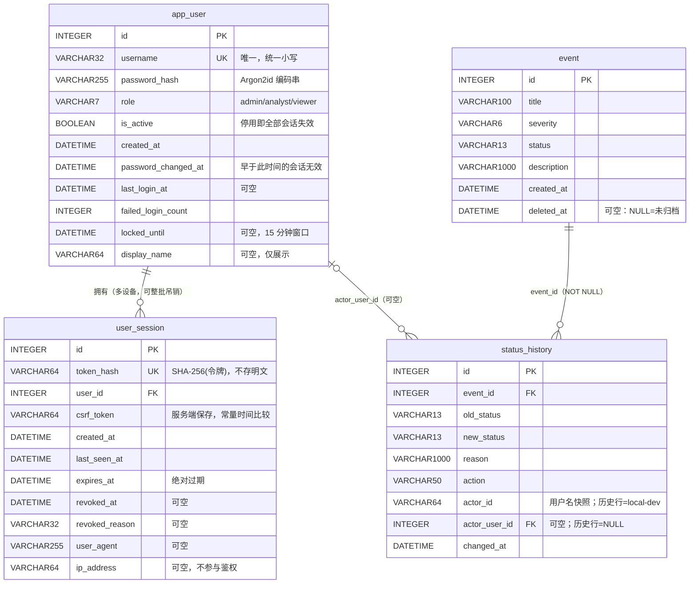

# CyberWatch V0.5 Identity & Access Management —— 需求与架构设计

| 项     | 值                                                                                                                                       |
| ----- | --------------------------------------------------------------------------------------------------------------------------------------- |
| 目标版本  | V0.5 Identity & Access Management                                                                                                       |
| 基线版本  | V0.4.2                                                                                                                                  |
| 基线提交  | `8f4d0de`（Merge PR #3 from `feature/status-history`）                                                                                    |
| 开发分支  | `feature/auth-rbac`（已存在，工作区干净）                                                                                                          |
| 远端    | <https://github.com/peitwo/CyberWatch>                                                                                                  |
| 本文档状态 | **评审通过**（2026-10-16）。本修订版（R1）落实 10 项评审意见，摘要见 [§0.5](#05-修订摘要r1--评审意见落实清单)                                                               |
| 修订版本  | R1（2026-10-16）：模块分层统一 · 路由安全守卫 · 限流 DoS 风险 · 0006 真实外键 · 退出登录语义统一 · PowerShell 流程 · 生产迁移备份 · `test_events` 夹具 · Swagger 策略 · V0.5.1 覆盖面 |
| 长期目标  | 让 CyberWatch 成为可供个人与小型团队**安全部署**的开源网络安全运营平台                                                                                             |

---

## 0. 结论摘要（先看这一节）

### 0.1 十条关键设计决定

| #   | 决定                                                                                             | 一句话理由                                                                  |
| --- | ---------------------------------------------------------------------------------------------- | ---------------------------------------------------------------------- |
| D1  | 用户表名用 **`app_user`**（不是 `user`）                                                                | `user` 在 PostgreSQL/MySQL 是保留字，而 PostgreSQL 是路线图上的下一步                  |
| D2  | 密码哈希用 **Argon2id**，直接调 `argon2-cffi`，**不用 passlib**                                            | passlib 已停止维护且与新版 argon2-cffi 存在兼容问题                                   |
| D3  | 会话 = **服务端随机令牌 + 只在库里存 SHA-256 哈希**，Cookie 只放原始令牌                                              | 数据库泄露 ≠ 会话被冒用；不需要任何签名密钥                                                |
| D4  | CSRF 用 **双提交 + 服务端存储校验**，且**强制挂在 `require()` 依赖里**                                             | 结构上不可能"忘记给某个写接口加 CSRF"                                                 |
| D5  | 审计归属采用 **「用户名快照 + 可空外键」双列**（`actor_id` + `actor_user_id`）                                      | 既不改写历史行，又能抗用户改名/停用，还能追责                                                |
| D6  | 历史行 `local-dev` **原样保留**，`actor_user_id` 留 NULL                                                | 需求硬约束：不能凭空把历史操作归属给新管理员                                                 |
| D7  | 用户**只停用、不物理删除**（没有 `DELETE /users/{id}`）                                                       | 与项目既有的"软删除保审计"哲学一致，外键永不悬挂                                              |
| D8  | 新增表**一律不写 `server_default`**                                                                   | 新建表没有"旧行要回填"问题，可避免「迁移建表」与「create_all 建表」DDL 漂移                         |
| D9  | 权限是**集中式权限常量表 + 依赖**，不是散落在各路由的 `if role ==`                                                    | 矩阵本身可被测试遍历，新增路由忘挂权限会被测试抓出来                                             |
| D10 | 未认证访问：**HTML 路由 302 跳 `/login`，JSON API 返回 401**                                               | 浏览器体验与程序化调用各自最优；403 专用于"已登录但权限不足"/CSRF 失败                              |
| D11 | 模块分层固定为 **`config → database → models → permissions → security → auth → cli → main`**（单向依赖，无环） | 消除"模型散在 `auth.py` 与 `main.py` 两处"的不一致（R1-1）                            |
| D12 | **所有** SQLModel 表模型集中在 `app/models.py`；`main.py` **re-export** 旧名字保持导入兼容                       | 测试与 `migrations/env.py` 都按 `app.main.X` 取名字，重导出可让它们零改动                 |
| D13 | 权限矩阵**在 V0.5.1 即按最终角色生效**（而不是"先只做认证、角色留到 V0.5.2"）                                              | 与 `require()` 是同一段代码，写一次即可；V0.5.2 交付的是**用户管理 API/UI** 与三角色浏览器验收（R1-10） |
| D14 | `POST /auth/logout` **永远返回 204（幂等）**，未登录调用**不会**得到 401                                         | 前端登出必须能无条件清理本地状态；有会话时仍需 CSRF（R1-5）                                     |
| D15 | 账号级锁定是**已知可用性风险**；公开部署**必须**在反向代理层做来源级限流                                                       | 诚实记录 DoS 面，而不是假装账号锁定足够（R1-3）                                           |

### 0.2 本次调查发现的两处**现状与旧认知不符**，必须先说

1. **真实库已经推进到 `0004`**（不再是我此前记录的 `0002`）。  
   只读核查（`file:...?mode=ro`，未写入任何字节）结果：
   - `alembic_version = 0004`
   - 表：`alembic_version`、`event`、`status_history`
   - `event` 3 行（全部 `status=open`、`deleted_at=NULL`），`status_history` **0 行**
   - 文件 28672 bytes，mtime `2026-10-16 14:11:10`  
     → 说明 `0003`/`0004` 已由用户在合并 PR #3 后应用到真实库。  
     **对设计的影响**：V0.5 的迁移从 `0005` 开始；且 `status_history` 里目前**没有任何 `local-dev` 行**。
2. **`status_history.actor_id` 是 `VARCHAR(64) NOT NULL`，无外键、无 server_default**，值由应用硬编码写入 `"local-dev"`（`app/main.py` 三处：`update_event` / `delete_event` / `restore_event`）。

### 0.3 兼容性总评

| 维度              | 结论                                                                                                                          |
| --------------- | --------------------------------------------------------------------------------------------------------------------------- |
| 数据库数据           | **零破坏**。0005/0006 只有 `CREATE TABLE` / `CREATE INDEX` / `ADD COLUMN NULL`，没有任何 `DROP`/`DELETE`/`UPDATE`，真实库 3 行事件与既有审计行逐字段不变 |
| 现有 API 契约       | **请求/响应体不变**；`GET /events/{id}/history` 的响应**新增一个字段** `actor_user_id`（向后兼容，前端不依赖固定字段集）                                      |
| 现有 141 项 pytest | **全部保留**；但 `client` 夹具需改为"默认已登录"，另有 **3 处 `actor_id == "local-dev"` 断言**需随语义更新，`tests/test_events.py` 的**自有夹具**需同步 3 行      |
| 前端              | 需新增登录页与统一 fetch 封装；`/dashboard` 未登录会 302，因此**现有浏览器验收脚本必须先登录**                                                               |
| 依赖              | **新增 `argon2-cffi`**（本轮不安装，待评审批准）                                                                                           |

### 0.4 决策点状态

10 项产品决策**已由评审全部采纳**，逐条批复见 [第 10 节](#10-决策点批复结果r1)。实现形态不再有待定项。

### 0.5 修订摘要（R1 / 评审意见落实清单）

本版（R1，2026-10-16）针对评审提出的 10 项意见逐条修订。**每条都给出"改了什么、落在文档哪一节、如何验证"**，便于对照验收。

| #     | 评审意见                                                                                                                                                     | 本版修订结论                                                                                                                                                                                         | 落点                    | 验证方式                                                                                                 |
| ----- | -------------------------------------------------------------------------------------------------------------------------------------------------------- | ---------------------------------------------------------------------------------------------------------------------------------------------------------------------------------------------- | --------------------- | ---------------------------------------------------------------------------------------------------- |
| R1-1  | 统一 User / UserSession / StatusHistory 的模块位置，消除 `auth.py` 与 `main.py` 两套方案的不一致；优先 `models.py`/`security.py`/`auth.py`/`permissions.py`/`cli.py` 分层，避免循环导入 | **采纳**。新增 `app/models.py`（**全部**表模型与 schema 集中于此）+ `app/database.py`（engine/`get_session`，切断 main↔auth 的循环）；`auth.py` 只管会话与鉴权服务，不再声明模型。§2.0、§8.0 给出完整依赖图与"谁可以 import 谁"的规则                     | §2.0、§8.0、§8.1        | `test_architecture.py::test_import_graph_is_acyclic`（AST 静态扫描 import，断言无环且层级不越级）                     |
| R1-2  | 增加全量路由安全守卫测试，确保新接口不能遗漏认证/权限/CSRF；明确登录接口等例外及补偿                                                                                                            | **采纳**。新增 `app/permissions.py::ROUTE_POLICY`（**路由 → 策略**的唯一真相），并新增 3 个守卫测试：①路由表完整性（未登记的路由直接失败）②匿名请求全量 401/302 ③写方法全量 CSRF 403。例外仅 4 个并逐条给出补偿措施                                                 | §4.2.1、§4.2.2、§6.1    | `tests/test_routes_guard.py`（3 个测试，覆盖 27 个路由 + 4 个例外）                                                |
| R1-3  | 账号级登录失败限制的拒绝服务风险写入设计；公开部署前必须有来源级限流与可信代理配置                                                                                                                | **采纳**。新增 §5.3 专节：威胁建模（已知用户名持续锁死 → 服务不可用）、4 条现有缓解、**公开部署的强制前置条件**（反代 `limit_req` + 可信代理 + `CYBERWATCH_TRUST_PROXY` 仅在后置信任链时开启），并明确"账号锁定**不能**单独作为公开部署的限流方案"                                    | §5.3、§2.9             | §5.3 的检查清单 + `AuthSettings` 生产 fail-fast（`trust_proxy=true` 但未声明 `trusted_proxy_cidrs` → 拒绝启动）       |
| R1-4  | 0006 迁移明确 `actor_user_id` 的**真实外键约束**，要求在临时库用 `PRAGMA foreign_key_list` 验证                                                                               | **采纳**。§3.3 给出改写后的 0006 代码（`sa.ForeignKey("app_user.id")`）与**实测证据**：临时库 `PRAGMA foreign_key_list(status_history)` 输出 `[('app_user','actor_user_id','id')]`（R1 实测，见下）                           | §3.3                  | `test_migrations.py::test_migration_0006_adds_real_foreign_key`（断言 `PRAGMA foreign_key_list` 而非只看列名） |
| R1-5  | 统一退出登录的未认证响应约定，避免权限矩阵与实现说明冲突                                                                                                                             | **采纳**（原文档确有冲突：§2.6 说 204、§2.8 又说 401）。**统一为 204 幂等**；§2.8 已修正，§4.3 矩阵与 §4.2.2 例外表一致                                                                                                           | §2.6、§2.8、§4.2.2、§4.3 | `test_auth.py::test_logout_without_session_is_still_204`                                             |
| R1-6  | 增加初始化管理员与首次启动的完整 PowerShell 操作流程                                                                                                                         | **采纳**。新增 §12 附录：从零到可登录的**逐条可复制** PowerShell 流程（虚拟环境 → 迁移 → 建管理员 → 启动 → 登录验证），含每一步的**预期输出**与失败排查                                                                                               | §12                   | 本轮真实执行（见 V0.5.1 报告的执行日志）                                                                             |
| R1-7  | 明确生产数据库迁移前必须备份、核对目标路径、验证数据完整性                                                                                                                            | **采纳**。新增 §9.6「生产迁移三段式规程」：①备份 + sha256 留档 ②核对实际目标路径（打印 `resolve_database_url` 结果 + 文件大小/mtime）③迁移后完整性核对（行数、`PRAGMA foreign_key_check`、`integrity_check`）                                       | §9.6                  | 本轮在**真实库副本**上执行一次全流程                                                                                 |
| R1-8  | 允许修改 `tests/test_events.py` 的登录夹具，保留全部原有业务断言，同时增加匿名用户与低权限用户测试                                                                                            | **批准**。`test_events.py` 的 16 条断言**一字不改**，仅其局部 `client` 夹具加登录；另**新增**匿名 401 与 viewer 403 用例。§6.3 给出逐条对照                                                                                         | §6.3、§9.2             | `test_events.py`（16 条原断言 + 新增 2 组权限用例）                                                               |
| R1-9  | Swagger 的开发环境公开策略仅适用于本机隔离环境；生产默认管理员可见                                                                                                                    | **采纳并强化**。`docs_mode` 在 `development` 下默认 `public` 时，**启动打印醒目警告**并标注"仅限本机隔离环境"；`production` 默认 `admin`；`production` + `public` 需 `CYBERWATCH_ALLOW_PUBLIC_DOCS=1` 显式二次确认                       | §4.5.4、§2.9           | `test_auth.py` docs_mode 三态用例 + `AuthSettings` 校验用例                                                  |
| R1-10 | V0.5.1 认证保护必须覆盖**全部**既有业务 API；V0.5.2 再实现完整角色矩阵                                                                                                           | **采纳**。V0.5.1 把 `require()` 挂到**每一个**既有业务路由（含 `/events/archived`、`/events/archived/count`、`/events/{id}/history`、`/events/{id}/restore`）；权限常量与矩阵**同版落地**（见 D13），V0.5.2 交付用户管理 API/UI 与三角色浏览器验收 | §7 V0.5.1/V0.5.2 范围表  | R1-2 的路由守卫测试即为"无遗漏"的机器证明                                                                             |

> **R1 期间的一处设计自我修正**：原 §3.3 只写了 `op.add_column(..., sa.Column(...))`（**没有把外键渲染进 DDL**），却把"真实外键"写进了 §3.1 的 ER 图 —— 文档内部自相矛盾。R1 已修正代码并**实测**证实（见 §3.3.1）。

---

## 1. 现有项目调查报告

### 1.1 代码库结构（基线 `8f4d0de`）

```
cyberwatch-starter/
├── app/
│   ├── config.py            82 行  路径 / DB URL / PRAGMA 外键（app 与 Alembic 共用）
│   └── main.py             483 行  全部模型 + 全部路由 + 静态挂载
├── migrations/
│   ├── env.py               79 行  URL 解析先读调用方，再回落
│   └── versions/            0001 · 0002 · 0003 · 0004
├── static/
│   ├── dashboard.css       122 行  粉色 Kawaii 设计变量 + 压缩单行规则
│   └── dashboard.js        330 行  原生 JS，全文 textContent
├── templates/dashboard.html 10 行  压缩单行，7 个 <dialog>
├── tests/                  7 个文件 / 141 条用例
├── requirements.txt        fastapi · uvicorn · sqlmodel · alembic · pytest · httpx
├── alembic.ini             纯 ASCII，sqlalchemy.url 故意留空
└── cyberwatch.db           真实库（当前 0004）
```

**架构事实（会约束 V0.5 的设计）**

- **全部模型与全部路由都在 `app/main.py`**（单文件）。`migrations/env.py` 通过 `import app.main` 触发模型注册。
- 无任何中间件、无 CORS、无健康检查端点（`grep` 全空）。
- 前端为**同源**纯静态资源（`/static` 由 `StaticFiles` 挂载），无构建步骤、无 React。
- `app/main.py` 全文**零 `innerHTML`**，45 处 `textContent` —— 这是既有的硬安全约束。

### 1.2 API 路由全量清单 + 未来认证/角色需求

FastAPI 会额外自动注册 `/openapi.json`、`/docs`、`/docs/oauth2-redirect`、`/redoc`。

| #  | 方法     | 路径                       | 当前 | V0.5 所需权限             | admin   | analyst | viewer  | 备注                                |
| -- | ------ | ------------------------ | -- | --------------------- | ------- | ------- | ------- | --------------------------------- |
| 1  | GET    | `/`                      | 公开 | 公开（仅版本信息）             | ✔       | ✔       | ✔       | 不含任何业务数据                          |
| 2  | GET    | `/dashboard`             | 公开 | 已认证（HTML）             | ✔       | ✔       | ✔       | 未认证 → **302** `/login?next=`      |
| 3  | GET    | `/static/*`              | 公开 | 公开                    | ✔       | ✔       | ✔       | 登录页样式/脚本；不放敏感数据                   |
| 4  | GET    | `/docs` `/redoc`         | 公开 | 由 `docs_mode` 决定      | 仅 admin | ✘       | ✘       | 见 §4.5                            |
| 5  | GET    | `/openapi.json`          | 公开 | 同上                    | 仅 admin | ✘       | ✘       | 生产不建议公开                           |
| 6  | POST   | `/events`                | 公开 | `event.create`        | ✔       | ✔       | **403** |                                   |
| 7  | GET    | `/events`                | 公开 | `event.read`          | ✔       | ✔       | ✔       | 普通列表（已隐藏归档）                       |
| 8  | GET    | `/events/archived`       | 公开 | `event.read`          | ✔       | ✔       | ✔       | 归档中心列表（只读）                        |
| 9  | GET    | `/events/archived/count` | 公开 | `event.read`          | ✔       | ✔       | ✔       | 必须排在 `/{event_id}` 之前             |
| 10 | GET    | `/events/{id}`           | 公开 | `event.read`          | ✔       | ✔       | ✔       | 归档事件 → 404                        |
| 11 | GET    | `/events/{id}/history`   | 公开 | `audit.read`          | ✔       | ✔       | ✔       | 归档事件的历史仍可读                        |
| 12 | PATCH  | `/events/{id}`           | 公开 | `event.update`        | ✔       | ✔       | **403** | 归档事件 → 409                        |
| 13 | DELETE | `/events/{id}`           | 公开 | `event.archive`       | ✔       | ✔       | **403** | **语义是"归档"，不是删除**                  |
| 14 | POST   | `/events/{id}/restore`   | 公开 | `event.restore`       | ✔       | ✔       | **403** |                                   |
| 15 | POST   | `/auth/login`            | —  | 公开                    | ✔       | ✔       | ✔       | 唯一无会话的写接口，靠 Origin + 限流           |
| 16 | POST   | `/auth/logout`           | —  | 已认证 + CSRF            | ✔       | ✔       | ✔       | 幂等 204                            |
| 17 | GET    | `/auth/me`               | —  | 已认证                   | ✔       | ✔       | ✔       |                                   |
| 18 | POST   | `/auth/password`         | —  | 已认证 + CSRF            | ✔       | ✔       | ✔       | 改**自己**的密码                        |
| 19 | GET    | `/healthz`               | —  | 公开                    | ✔       | ✔       | ✔       | 建议新增，部署探针，仅 `{status:"ok"}`       |
| 20 | GET    | `/users`                 | —  | `user.read`           | ✔       | **403** | **403** | V0.5.2                            |
| 21 | POST   | `/users`                 | —  | `user.create`         | ✔       | **403** | **403** | V0.5.2，**唯一**的建号入口（除 CLI）         |
| 22 | GET    | `/users/{id}`            | —  | `user.read`           | ✔       | **403** | **403** | V0.5.2                            |
| 23 | PATCH  | `/users/{id}`            | —  | `user.update`         | ✔       | **403** | **403** | 改 role / is_active / display_name |
| 24 | POST   | `/users/{id}/password`   | —  | `user.reset_password` | ✔       | **403** | **403** | 管理员重置他人密码                         |
| 25 | DELETE | `/users/{id}/sessions`   | —  | `user.update`         | ✔       | **403** | **403** | 可选：把某用户全部踢下线                      |
| —  | DELETE | `/users/{id}`            | —  | **不提供**               | —       | —       | —       | 用户只停用，见 D7                        |

### 1.3 `status_history.actor_id` 现状与历史数据兼容问题

| 项       | 现状                                                                                               |
| ------- | ------------------------------------------------------------------------------------------------ |
| DDL     | `actor_id VARCHAR(64) NOT NULL`，**无 server_default**，**无外键**                                     |
| 写入位置    | `app/main.py` 三处硬编码 `DEFAULT_ACTOR_ID = "local-dev"`                                             |
| 客户端可伪造吗 | **不可以**。`EventUpdate` 是 `extra="forbid"`，传 `actor_id` 直接 422（已有测试覆盖）                             |
| 真实库现有数据 | **0 行**（`status_history` 空表）→ 真实库上不存在"待归属的历史操作"                                                  |
| 测试依赖    | `tests/test_status_history.py:97,351`、`tests/test_restore.py:162` 三处断言 `actor_id == "local-dev"` |


**设计上要回答的核心问题**：`actor_id` 怎么和真实 `User` 关联，同时不篡改历史？

三种方案评估：

| 方案                                        | 做法                                            | 优点                                                                | 致命缺点                                                                           | 结论              |
| ----------------------------------------- | --------------------------------------------- | ----------------------------------------------------------------- | ------------------------------------------------------------------------------ | --------------- |
| A. 改 `actor_id` 为外键指向 `app_user.username` | 单列                                            | 简单                                                                | ①必须给历史行造一个 `local-dev` 账号才能满足外键 → **等于凭空归属**，违反需求；②用户改名会连带改审计；③用户停用/删除会让历史失去引用 | ✘ 否决            |
| B. 保持字符串，不改结构                             | 靠 `username` 字符串 JOIN                         | 零迁移                                                               | 无引用完整性；用户改名后无法追溯；"这个 local-dev 到底是谁"永远无解                                       | ✘ 不作为终态         |
| **C. 用户名快照 + 可空外键（双列）**                   | 保留 `actor_id`（快照），新增 `actor_user_id`（NULL 允许） | ①历史行**一个字节都不改**；②新行既有可读用户名又有可追责外键；③抗改名/停用；④`ADD COLUMN NULL` 天然无损 | 需要一条迁移                                                                         | **✔ 采纳（D5/D6）** |

**取值规则（唯一入口，集中在一个函数里）**

| 场景                        | `actor_id`              | `actor_user_id`   |
| ------------------------- | ----------------------- | ----------------- |
| 登录用户改状态 / 归档 / 恢复         | `current_user.username` | `current_user.id` |
| 历史行（0004 及以前写入）           | `"local-dev"`（原样不动）     | `NULL`（新增列默认）     |
| 未来系统动作（自动归档、CLI 批处理、迁移脚本） | `"system"`              | `NULL`            |
| 无请求上下文（单测直接调内部函数）         | 必须显式传入，**不允许默认值**       | 同上                |

> `DEFAULT_ACTOR_ID = "local-dev"` 这个常量**保留为 `LEGACY_ACTOR_ID`**，只用于「识别历史行」，**不再用于任何新写入**。

### 1.4 数据库 URL / Alembic / 测试隔离机制（逐条核实）

| 机制                    | 实现                                                                                                                  | V0.5 是否沿用                            |
| --------------------- | ------------------------------------------------------------------------------------------------------------------- | ------------------------------------ |
| URL 单一真相              | `app/config.py::resolve_database_url(explicit)`；优先级 `explicit > CYBERWATCH_DATABASE_URL > <BASE_DIR>/cyberwatch.db` | ✅ 沿用，新增认证相关 env 也集中进 `app/config.py` |
| 默认路径不依赖 cwd           | `BASE_DIR = Path(__file__).resolve().parent.parent`                                                                 | ✅                                    |
| Alembic 不覆盖调用方        | `migrations/env.py` 先读 `config.get_main_option("sqlalchemy.url")`，有值就以它为准                                           | ✅ 关键，不能动                             |
| `alembic.ini` 纯 ASCII | 避免中文 Windows 上 GBK 解码崩溃                                                                                             | ✅                                    |
| 测试进程不可能连真实库           | `tests/conftest.py` 在 **import app 之前** 设 `CYBERWATCH_DATABASE_URL` → `%TEMP%\cyberwatch-tests-xxxx\`               | ✅                                    |
| 测试建表路径                | ⚠️ conftest 用 `SQLModel.metadata.create_all()`，**不是 Alembic**                                                       | ✅ 沿用，但**必须**让模型与迁移 DDL 完全一致（见 §3.6）  |
| 迁移测试隔离                | `tmp_path` + `Config.set_main_option("sqlalchemy.url", ...)` + `assert_in_tempdir()`                                | ✅ 新增 0005/0006 用例沿用同一套工具             |
| 启动只读检查                | `ensure_schema_ready()`：缺列/缺表就抛中文指引，**绝不改库**                                                                        | ⚠️ 需扩展检查 `app_user` / `user_session` |

### 1.5 V0.4.2 现有功能的兼容性风险清单

| #   | 风险                                              | 触发点                                                                | 等级   | 处理方案                                                                                |
| --- | ----------------------------------------------- | ------------------------------------------------------------------ | ---- | ----------------------------------------------------------------------------------- |
| R1  | **141 项测试全部变成 401**                             | 现有测试 **150+ 处** API 调用**全部不带凭证**（grep `headers=`/`cookies=` 结果为 0） | 🔴 高 | `conftest.py` 的 `client` / `client_and_engine` 夹具改为"临时库 + 默认以 admin 登录"；用例体**一行不改** |
| R2  | `tests/test_events.py` 有**自己的** `client` 夹具     | 该文件局部夹具覆盖 conftest，既不登录、也没开 `PRAGMA foreign_keys`                  | 🔴 高 | 该夹具内加 3 行登录（详见 §9.2），断言全部保持                                                         |
| R3  | **3 处 `actor_id == "local-dev"` 断言会失败**         | 登录后写入的是真实用户名                                                       | 🟡 中 | 断言改为"等于当前登录用户名"（语义更新，测试目标——"审计记录了操作人"——不变）                                          |
| R4  | `test_migrated_schema_matches_model_schema` 会漂移 | 0006 给 `StatusHistory` 加列后，模型与迁移必须同时更新，`HISTORY_COLUMNS` 常量也要加     | 🟡 中 | 同步更新常量，并把守卫扩展到 `app_user` / `user_session` 两张新表                                     |
| R5  | 浏览器验收脚本全断                                       | `/dashboard` 未登录 302 → 脚本拿不到页面                                     | 🟡 中 | 脚本前置"登录"步骤（脚本在临时目录，不入库）                                                             |
| R6  | `/docs`、`/openapi.json` 目前公开                    | 生产会泄露完整接口与数据结构                                                     | 🟡 中 | 引入 `CYBERWATCH_DOCS_MODE`；生产默认 `admin`                                              |
| R7  | Swagger「Try it out」与 CSRF 冲突                    | 写操作需要 `X-CSRF-Token` 头，Swagger 无法自动加                               | 🟢 低 | 在 `securitySchemes` 里声明 `X-CSRF-Token`（apiKey/header），文档说明手动填入                      |
| R8  | `DELETE /events/{id}` 语义是归档                     | 容易与"删除事件"混淆，影响权限命名                                                 | 🟢 低 | 权限命名用 `event.archive`；文档与前端文案已在 V0.4.2 统一为"归档"                                      |
| R9  | 无 per-event 归属 → viewer/analyst 可见**全部**事件      | "Viewer 只能查看**有权限访问的**事件"中"有权限"的定义目前只能是"全部未归档事件"                   | 🟢 低 | **明确记录**：V0.5 不做 per-event ACL；`event.created_by` 列入 V0.6 候选（见 §10.3）               |
| R10 | 时区：SQLite 丢弃 tzinfo                             | 会话过期比较若走 SQL 字符串比较会错                                               | 🟡 中 | 所有时间比较**在 Python 侧**做，读回值统一 `normalize_utc()`（见 §2.3）                               |
| R11 | 前端 401 处理缺失                                     | 现有 `fetch` 无统一封装，会话过期只会显示"加载失败"                                    | 🟡 中 | 新增共享 `static/api.js`：自动带 CSRF、401 → 跳登录                                             |
| R12 | 无 CORS（同源）                                      | 若未来开放跨域，Cookie 认证会立刻变复杂                                            | 🟢 低 | **明确不启用 CORS**，并在 README 写明理由                                                       |

---

## 2. 账号系统设计

### 2.0 模块分层与依赖方向（R1-1）

原设计稿把 `User` / `UserSession` 放在 `auth.py`、把 `Event` / `StatusHistory` 留在 `main.py`，形成"模型散落两处"的不一致：`auth.py` 需要 `StatusHistory` 的类型做审计关联，`main.py` 又需要 `User` 做鉴权，两边都 import 对方，**必然循环导入**。R1 用"模型集中 + 依赖单向"彻底解决。

**目录与行数（目标）**

```
app/
├── config.py        (既有) 路径 / DB URL / PRAGMA 外键 / 【新增】AuthSettings
├── database.py      (新)   engine、get_session、SessionDep        ← 切断 main↔auth 的环
├── models.py        (新)   全部枚举 + 全部表模型 + 全部请求/响应 schema
├── permissions.py   (新)   Permission 枚举、角色→权限矩阵、ROUTE_POLICY、has_permission
├── security.py      (新)   Argon2id 哈希 / 令牌 / SHA-256 / 常量时间比较 / utcnow
├── auth.py          (新)   会话读写、Cookie、CSRF、get_current_user、require()、/auth/* 路由
├── cli.py           (新)   create-admin（后续 list-users / set-role / reset-password）
└── main.py          (改)   业务路由 + include_router(auth) + 静态挂载 + 【re-export 旧名字】
```

**依赖方向（严格单向，箭头 = "可以 import"）**

```
config.py ──► database.py ──► models.py ──► permissions.py ──► auth.py ──► main.py
                                   ▲                                  ▲
                                   └──────── security.py ─────────────┘
                                                  ▲
                                              cli.py ──► main.py（只需 app 用于 lifespan? 否；cli 不 import main）
```

| 模块               | 允许 import 谁                                           | **禁止** import 谁              | 理由                           |
| ---------------- | ----------------------------------------------------- | ---------------------------- | ---------------------------- |
| `config.py`      | 仅标准库 + sqlalchemy                                     | 任何 `app.*`                   | 必须能在 Alembic 里裸导入            |
| `database.py`    | `config`                                              | `models` / `auth` / `main`   | engine 必须早于模型存在              |
| `models.py`      | 标准库 + sqlmodel/pydantic                               | `database` / `auth` / `main` | 模型是纯声明，不碰引擎                  |
| `security.py`    | 标准库 + argon2                                          | 任何 `app.*`                   | 纯函数，最易单测                     |
| `permissions.py` | `models`（取 `Role`）                                    | `auth` / `main`              | 矩阵是数据，不是逻辑                   |
| `auth.py`        | `models` `security` `permissions` `database` `config` | `main`                       | **关键**：auth 不许回头 import main |
| `cli.py`         | `models` `security` `database` `config`               | `auth`（避免拉起路由） / `main`      | CLI 只要模型与哈希                  |
| `main.py`        | 以上全部                                                  | —                            | 顶层组装者                        |

**为什么必须单独拆出 `database.py`**：若把 `engine` / `get_session` 留在 `main.py`，那么 `auth.py` 的 `/auth/login` 路由要用 `SessionDep` 就必须 `from app.main import get_session` → `main` 又 `from app.auth import auth_router` → **循环导入**。把 `engine` / `get_session` 下沉到 `database.py` 是消除该环的最小改动。

**`main.py` 必须保留的 re-export（导入兼容，不是可选）**：现有测试与 `migrations/env.py` 按 `app.main.X` 取名字，R1 不改它们，因此 `main.py` 顶部必须继续导出：

```python
DATABASE_URL, engine, get_session, SessionDep,
Severity, Status, Event, EventBase, EventCreate, EventUpdate, EventRead,
StatusHistory, StatusHistoryRead, ArchivedEventRead, ArchivedEventCount,
ACTION_STATUS_CHANGE, ACTION_ARCHIVE, ACTION_RESTORE, DEFAULT_ACTOR_ID, LEGACY_ACTOR_ID,
requires_status_reason, app                       # app 是 FastAPI 实例
```

> 这 5 行 re-export 是本设计**唯一**的"兼容债"，换来的是 `tests/test_config.py`、`test_migrations.py`、`test_restore.py`、`test_status_history.py`、`conftest.py` **零改动**。

### 2.1 数据模型 `User`（表 `app_user`）

| 字段                    | 类型           | 约束                     | 说明                                                                     |
| --------------------- | ------------ | ---------------------- | ---------------------------------------------------------------------- |
| `id`                  | INTEGER      | PK                     |                                                                        |
| `username`            | VARCHAR(32)  | **UNIQUE**、NOT NULL、索引 | 允许 `[a-z0-9._-]{3,32}`，**统一转小写**后存储与比较                                 |
| `password_hash`       | VARCHAR(255) | NOT NULL               | Argon2id 编码串（`$argon2id$v=19$m=65536,t=3,p=2$...`）                     |
| `role`                | VARCHAR(7)   | NOT NULL               | `admin` / `analyst` / `viewer`（`VARCHAR(7)` 来自最长值 `analyst`，必须与迁移逐字一致） |
| `is_active`           | BOOLEAN      | NOT NULL               | 停用即**所有会话立即失效**                                                        |
| `created_at`          | DATETIME     | NOT NULL               |                                                                        |
| `password_changed_at` | DATETIME     | NOT NULL               | **早于该时刻创建的会话一律无效**（改密兜底防线）                                             |
| `last_login_at`       | DATETIME     | NULL                   | 尽最大努力记录，登录失败不更新                                                        |
| `failed_login_count`  | INTEGER      | NOT NULL               | 成功登录清零                                                                 |
| `locked_until`        | DATETIME     | NULL                   | 短时软锁定窗口                                                                |
| `display_name`        | VARCHAR(64)  | NULL                   | 仅 UI 展示，不参与鉴权                                                          |

**为什么没有 `is_superuser` / `is_staff`**：三个角色已能表达全部权限差异，多一个布尔位等于把权限模型打散到两处，容易产生"谁能改谁"的歧义。

### 2.2 密码哈希（Argon2id）

- 依赖：`argon2-cffi>=23.1,<26`（**本轮不安装**，见 §8.3）
- 直接用 `argon2.PasswordHasher`，**不使用 passlib**（已停止维护，且与新版 argon2-cffi/bcrypt 存在已知不兼容）
- 参数（交互式登录档位，OWASP 建议之上）：
  | 参数                      | 值             | 说明                         |
  | ----------------------- | ------------- | -------------------------- |
  | `type`                  | `Type.ID`     | **Argon2id**（抗 GPU + 抗侧信道） |
  | `time_cost`             | 3             | 迭代次数                       |
  | `memory_cost`           | 65536（64 MiB） | 内存硬度                       |
  | `parallelism`           | 2             |                            |
  | `hash_len` / `salt_len` | 32 / 16       | 盐随机自动生成                    |
- **`ph.check_needs_rehash(hash)` → 登录成功时静默升级**哈希参数（未来调参不会锁死老用户）
- **时序对齐**：用户名不存在时，仍然对一个固定的 `DUMMY_HASH` 执行一次 `verify()`，让"用户不存在"和"密码错误"耗时接近，避免用户枚举侧信道
- **长度限制**：请求侧 `min_length=12`（管理员可配置）、`max_length=128`——上限是防 DoS（Argon2 会把整个密码读进内存）
- **口令策略**：只做"长度 + 不等于用户名 + 不在一个约 200 条的常见弱口令表内"，**不强制大小写/符号组合**（NIST SP 800-63B 立场）
- **请求模型用 `SecretStr`**：避免 password 被 repr / 日志 / 报错信息顺带打出来
- 响应模型**永不包含** `password_hash`（独立的 `UserRead`，字段清单里没有它）

### 2.3 会话（Session）设计

**令牌形态**

```
原始令牌 raw = secrets.token_urlsafe(32)        # 256 bit 熵，只存在于 Cookie
库中存储       = sha256(raw).hexdigest()          # 64 字符，永不存明文
```

**为什么不需要签名密钥**：令牌是纯随机不透明串，不是"用户名+过期时间"的签名结构；服务端以哈希查表即可。因此 **V0.5 不引入 `CYBERWATCH_SECRET_KEY`**（未来若做"记住我"签名 Cookie 或分布式限流再加）。

**表 `user_session`**

| 字段               | 类型           | 约束                               | 说明                                                                         |
| ---------------- | ------------ | -------------------------------- | -------------------------------------------------------------------------- |
| `id`             | INTEGER      | PK                               |                                                                            |
| `token_hash`     | VARCHAR(64)  | **UNIQUE**、NOT NULL、索引           | SHA-256(令牌)                                                                |
| `user_id`        | INTEGER      | NOT NULL、**FK → app_user.id**、索引 |                                                                            |
| `csrf_token`     | VARCHAR(64)  | NOT NULL                         | 32 字节随机 hex，服务端保存                                                          |
| `created_at`     | DATETIME     | NOT NULL                         | 用于对照 `password_changed_at`                                                 |
| `last_seen_at`   | DATETIME     | NOT NULL                         | 空闲超时基准                                                                     |
| `expires_at`     | DATETIME     | NOT NULL                         | **绝对**过期                                                                   |
| `revoked_at`     | DATETIME     | NULL                             | 非 NULL 即失效                                                                 |
| `revoked_reason` | VARCHAR(32)  | NULL                             | `logout`/`password_change`/`admin_reset`/`deactivated`/`expired`/`rotated` |
| `user_agent`     | VARCHAR(255) | NULL                             | 信息性（"我的登录设备"将来可用）                                                          |
| `ip_address`     | VARCHAR(64)  | NULL                             | 信息性；**不参与鉴权决策**                                                            |

**有效性判定（Python 侧、按序短路，全部满足才放行）**

```
1. 有 Cookie 且格式合法
2. 以 sha256(Cookie) 查到会话行          否则 401
3. revoked_at is None                    否则 401
4. now <= expires_at                     否则 401（reason=expired）
5. now - last_seen_at <= idle 上限        否则 401（reason=expired）
6. 用户存在且 is_active                   否则 401（reason=deactivated，并吊销其全部会话）
7. session.created_at >= user.password_changed_at   否则 401（改密兜底）
8. last_seen_at 距今 > 10 分钟才写回（滚动续期，降低写放大）
```

**时区纪律（对应 R10）**：SQLite 的 `DATETIME` **不保存 tzinfo**，写入时按字段分量落盘、读回是 naive。因此：

- 统一用 `utcnow()` 产生 **aware UTC**（与既有 `event.created_at` 一致）；
- 读回的时间一律经 `normalize_utc(dt)`（naive → 补 UTC）后再比较；
- **绝不用 SQL 字符串比较时间**，过期判定全在 Python 里做。

**会话固定攻击防护**：登录成功时**总是新建会话**（新令牌、新 CSRF），不复用 Cookie 里带来的任何令牌 → 攻击者预先塞入的令牌在登录后失效。

**多设备**：同一用户允许多条有效会话（不做单会话限制）；`revoked_reason` 便于排查。

**生命周期与清理**：绝对有效期 `CYBERWATCH_SESSION_TTL_HOURS`（默认 168 = 7 天）；空闲 `CYBERWATCH_SESSION_IDLE_MINUTES`（默认 720 = 12 小时）。失效行由"每进程每小时最多一次"的机会式清理删除（`expires_at < now-7d` 或 `revoked_at < now-7d`）。

### 2.4 Cookie 属性

| Cookie       | 值                         | HttpOnly       | SameSite | Secure         | Path | Max-Age  |
| ------------ | ------------------------- | -------------- | -------- | -------------- | ---- | -------- |
| `cw_session` | 原始令牌                      | **是**          | `Lax`    | 生产 **是**，开发否   | `/`  | = 绝对 TTL |
| `cw_csrf`    | 与 `session.csrf_token` 相同 | **否**（JS 必须能读） | `Lax`    | 同 `cw_session` | `/`  | = 绝对 TTL |


- **不设 `Domain`** → 绑定当前主机，天然排除子域共享
- `SameSite=Lax` 已能阻断跨站 `POST` 携带 Cookie，是 CSRF 的第一道防线；`cw_csrf` 是第二道
- 开发环境不给 `Secure`：`http://127.0.0.1` 下 `Secure` Cookie 行为依赖浏览器策略，默认关闭更可预测；**生产必须 HTTPS + `Secure`**
- `cw_csrf` 故意非 HttpOnly：它**本身不是凭证**（没有会话 Cookie 什么也做不了），JS 读它是双提交模式的前提

### 2.5 CSRF 防护

**双提交 + 服务端存储校验**（比纯双提交更强：不依赖"攻击者读不到 Cookie"这一假设）

```
写操作（POST / PATCH / PUT / DELETE）：
    请求头 X-CSRF-Token 必须存在
    常量时间比较：header == session.csrf_token
    失败 → 403 {"detail":"CSRF 校验失败"}
读操作（GET / HEAD / OPTIONS）：不要求
```

**架构上的硬保证**：CSRF 校验**写在 `require()` 依赖内部**——任何用 `require(...)` 保护的写接口都自动获得 CSRF 校验，**不存在"某个写接口忘了加"的可能**（对应 D4/D9）。

**唯一例外**：`POST /auth/login`。此刻还没有会话，无法校验。它的补偿控制是：

1. `SameSite=Lax` 使跨站 POST 不带 Cookie；
2. 校验 `Origin`（缺失时回落 `Referer`）与请求 `Host` 同源；`production` 下**缺失即拒绝**，`development` 下允许缺失（便于 curl/测试）。
3. 登录接口本身有失败限流。

**为什么 CSRF 失败返回 403 而不是 401**：401 语义是"未认证"，会让前端误判为"会话过期"而跳登录页；403 明确表示"你已登录，但这个请求不被接受"。

### 2.6 登录失败 / 用户停用 / 密码修改的会话规则

| 场景            | 规则                                                                            | 可观测结果                 |
| ------------- | ----------------------------------------------------------------------------- | --------------------- |
| 密码错误 / 用户名不存在 | **同一条 401 与同一段文案**（"用户名或密码错误"），未知用户也跑一次 Argon2 verify                         | 无法区分"账号是否存在"          |
| 连续失败          | 第 5 次起 `locked_until = now + 15min`，期间即使密码正确也 **401 + `Retry-After`**         | 不返回 423/429，避免泄露账号存在性 |
| 登录成功          | `failed_login_count = 0`、`locked_until = NULL`、`last_login_at = now`          |                       |
| 停用用户登录        | 401（同文案）                                                                      | 不提示"账号已停用"            |
| **使用中**账号被停用  | 下一次请求：第 6 步判定 `is_active=False` → **401 + 吊销该用户全部会话**（`reason=deactivated`）   | 停用**立即生效**，不等到期       |
| 用户自己改密        | 校验旧密码 → 更新哈希 + `password_changed_at` → **吊销该用户全部会话**（含当前） → 清 Cookie → 前端跳登录页 | 强制重新登录（对应决策点 10.6）    |
| 管理员重置他人密码     | 同上（吊销目标用户全部会话），**不影响管理员自己的会话**                                                | 被盗号者被立即踢出             |
| 管理员改角色        | 不吊销会话：角色在下一次请求就会生效（权限每次实时读库）                                                  | 提权/降权即时生效             |
| 用户自己登出        | `revoked_at/reason=logout` + 清两个 Cookie；未登录调用也返回 **204**（幂等）                  |                       |

**限流的诚实说明**：按账号锁定存在"已知用户名被恶意锁死"的 DoS 风险。缓解：窗口只有 15 分钟、成功后清零。按 IP 的令牌桶留到 V0.6（需引入部署层视野）。**该风险的完整建模、补偿控制与"公开部署强制前置条件"见 [§5.3](#53-登录失败限制的拒绝服务风险与公开部署前置条件r1-3)**——账号级锁定**不得**作为公开部署的唯一限流手段。

### 2.7 首位管理员通过本地 CLI 初始化

```
# 唯一的管理员引导入口（没有公开的"注册管理员"接口）
python -m app.cli create-admin --username admin --display-name 管理员

密码来源（二选一）：
  · 交互：getpass 两次输入 + 一致性校验（默认）
  · 非交互：--password-env CYBERWATCH_ADMIN_PASSWORD   （CI/自动化用）
```

CLI 行为约定：

| 情况                              | 行为                                           |
| ------------------------------- | -------------------------------------------- |
| 数据库缺表（未 `alembic upgrade head`） | 打印中文指引，退出码 **2**，**不建任何表**                   |
| 用户名已存在                          | 报错，退出码 **1**，**不改任何数据**                      |
| 密码强度不足                          | 报错，退出码 **1**                                 |
| 成功                              | 打印 `已创建管理员 admin（id=N）`，**绝不打印密码**；退出码 **0** |

**其它子命令（按阶段落地）**：`list-users`（0.5.2）、`set-role` / `deactivate` / `reset-password`（0.5.2/0.5.3）。

**为什么 CLI 而不是"首次启动自动建号"**：

- 启动自动建号会**写库**，与项目"启动只做只读检查"的既有铁律冲突；
- 会把密码塞进环境变量/默认值，容易在生产里留下弱口令；
- CLI 是显式的、可审计的一次性动作。

### 2.8 未认证访问规则（401 还是 302）

| 目标                                                                   | 未认证响应                                                               | 理由                                                                |
| -------------------------------------------------------------------- | ------------------------------------------------------------------- | ----------------------------------------------------------------- |
| `/dashboard`, `/docs`, `/redoc`，以及未来任何**HTML 路由**                    | **302 → `/login?next=<原路径>`**                                       | 浏览器体验；`next` 必须被校验（见下）                                            |
| `/events*`, `/users*`, `/auth/me`, `/auth/password`, `/openapi.json` | **401** + `WWW-Authenticate: Cookie` + JSON `{"detail":"未认证：请先登录"}` | 程序化调用需要明确的机器可读信号，不能返回 HTML                                        |
| `/auth/logout`                                                       | **204（幂等，永不 401）**                                                  | 登出是"清理"语义，不是"读取受保护资源"；未登录时本来就没有会话可吊销，报 401 只会让前端多写一条分支（R1-5 统一结论） |
| `/`, `/login`, `/healthz`, `/static/*`                               | 公开                                                                  | 不含敏感数据                                                            |
| CSRF 校验失败                                                            | **403**                                                             | 已登录但请求不被接受                                                        |
| 已登录但角色不足                                                             | **403**                                                             | 与"未认证"严格区分，前端提示"权限不足"而非跳登录                                        |

**`next` 开放重定向防护**：只接受满足全部条件的值——以 `/` 开头、不以 `//` 开头、不含 `\`、不含 `:`；不满足则忽略并回落 `/dashboard`。

### 2.9 环境变量与密钥配置（面向公开部署）

| 变量                                | 默认                              | 生产要求                                            | 说明                                                                                                        |
| --------------------------------- | ------------------------------- | ----------------------------------------------- | --------------------------------------------------------------------------------------------------------- |
| `CYBERWATCH_DATABASE_URL`         | `<项目根>/cyberwatch.db`           | 建议显式指定（如 `sqlite:////var/lib/cyberwatch/cw.db`） | 既有机制                                                                                                      |
| `CYBERWATCH_ENV`                  | `development`                   | **必须** `production`                             | 唯一的总开关，非法值启动即报错                                                                                           |
| `CYBERWATCH_COOKIE_SECURE`        | 跟随 `ENV`（prod=true / dev=false） | 反代 TLS 终止时也应为 `true`                            | 显式覆盖用                                                                                                     |
| `CYBERWATCH_SESSION_TTL_HOURS`    | `168`                           | 按需                                              | 绝对有效期                                                                                                     |
| `CYBERWATCH_SESSION_IDLE_MINUTES` | `720`                           | 按需                                              | 空闲超时                                                                                                      |
| `CYBERWATCH_COOKIE_NAME`          | `cw_session`                    | —                                               |                                                                                                           |
| `CYBERWATCH_DOCS_MODE`            | dev=`public` / prod=`admin`     | 建议 `admin`                                      | `admin` | `public` | `disabled`                                                                           |
| `CYBERWATCH_ALLOW_PUBLIC_DOCS`    | 无                               | **仅在明确要公开 docs 时设 `1`**                         | `production` + `DOCS_MODE=public` 的二次确认开关（R1-9）                                                           |
| `CYBERWATCH_TRUST_PROXY`          | `false`                         | **仅当应用确实在可信反代之后**才置 `true`                      | 置 `true` 后才会解析 `X-Forwarded-For` / `X-Forwarded-Proto`；**仅影响记录与 URL 生成，不参与鉴权决策**                          |
| `CYBERWATCH_TRUSTED_PROXY_CIDRS`  | 空                               | `TRUST_PROXY=true` 时**必填**                      | 逗号分隔的 CIDR 白名单（如 `127.0.0.1/32,10.0.0.0/8`）。**只要有一跳不在白名单，就忽略整条转发链**，防止伪造 `X-Forwarded-For` 污染日志与限流键（R1-3） |
| `CYBERWATCH_ADMIN_PASSWORD`       | 无                               | **只在 CLI 读取**，不进入应用运行时                          |                                                                                                           |
| `CYBERWATCH_SECRET_KEY`           | **不存在**                         | —                                               | V0.5 不需要（见 §2.3）；若将来引入签名 Cookie 再加                                                                        |

**`production` 启动期 fail-fast 检查清单**（全部不通过则拒绝启动，并打印中文原因）：

1. `CYBERWATCH_COOKIE_SECURE` 显式为 `false` → 拒绝启动（避免明文网络传会话）
2. `CYBERWATCH_DOCS_MODE=public` 需要额外显式确认 `CYBERWATCH_ALLOW_PUBLIC_DOCS=1`，否则拒绝
3. 数据库 URL 仍是默认的项目根路径 → 打 **WARNING**（生产应显式指定）
4. `CYBERWATCH_SESSION_TTL_HOURS` 非法 / 为 0 → 拒绝启动
5. **`CYBERWATCH_TRUST_PROXY=true` 但 `CYBERWATCH_TRUSTED_PROXY_CIDRS` 为空 → 拒绝启动**（R1-3：信任转发头却不限定来源，等于把日志与限流键交给攻击者）
6. 打印生效配置摘要（**不含任何密钥**）

**生产部署安全清单（写入 README）**：HTTPS 终结 + `Secure`；`--workers` 由部署方决定；SQLite 文件权限 600 且目录不可被 Web 用户以外的人写；定期备份（**备份含 `user_session`，等价于密码等价物，必须按敏感数据保护**）；容器里不挂载源码可写卷。

---

## 3. 数据库设计

### 3.1 数据库关系图（ER）



**纯文本版（便于 diff / 无 Mermaid 环境）**

```
app_user (1) ──< user_session (N)          user_id  NOT NULL FK
app_user (1) ──< status_history (N)        actor_user_id  NULL FK   ← 历史行为 NULL
event    (1) ──< status_history (N)        event_id  NOT NULL FK

app_user            user_session            status_history
────────────        ──────────────          ──────────────────
id           PK     id            PK        id            PK
username     UQ     token_hash    UQ        event_id      FK→event.id
password_hash       user_id       FK→app_user.id
role                csrf_token              old_status / new_status
is_active           created_at              reason / action
created_at          last_seen_at            actor_id        ← 用户名快照
password_changed_at expires_at              actor_user_id   ← 新增，可空 FK→app_user.id
last_login_at       revoked_at              changed_at
failed_login_count  revoked_reason
locked_until        user_agent / ip_address
display_name
```

**关系语义**

| 关系                          | 基数      | 删除策略                    | 理由               |
| --------------------------- | ------- | ----------------------- | ---------------- |
| `app_user → user_session`   | 1:N     | 用户**不物理删除**；停用/改密时批量吊销  | 避免"删用户 → 会话悬挂"   |
| `app_user → status_history` | 1:N（可空） | 用户不删除；`actor_id` 快照兜底   | 审计必须在用户改名/停用后仍可读 |
| `event → status_history`    | 1:N     | `event` 用软删除（V0.4.2 已定） | 外键永不悬挂，历史永不丢失    |

### 3.2 表结构要点与"必须逐字一致"的清单

因为 `conftest` 用 `create_all` 建测试库、而生产用 Alembic，**两条路径的 DDL 必须完全相同**，由 `test_migrated_schema_matches_model_schema` 守卫。以下写法容易踩坑，实现时必须逐项对齐：

| 项     | 模型侧                              | 迁移侧                                       | 陷阱                                                                                      |   |
| ----- | -------------------------------- | ----------------------------------------- | --------------------------------------------------------------------------------------- | - |
| 枚举列长  | `role: Role`                     | `sa.VARCHAR(length=7)`                    | SQLModel 用**最长枚举值**长度（`analyst`=7）。写成 10 会让守卫测试红                                        |   |
| 布尔列   | `is_active: bool`                | `sa.Boolean()`                            | SQLite 落成 `BOOLEAN`                                                                     |   |
| 默认值   | **只写 Python 侧 `default=`**       | **不写 `server_default`**                   | 一旦两侧写法不同（`DEFAULT '1'` vs `DEFAULT 1`），`PRAGMA table_info` 的 default 字符串不等 → 测试红（对应 D8） |   |
| 唯一索引  | `Field(unique=True, index=True)` | `op.create_index(..., unique=True)`       | 索引名必须一致（`ix_app_user_username`）                                                         |   |
| 可空 FK | \`int                            | None = Field(foreign_key="app_user.id")\` | `sa.Column(..., sa.Integer(), nullable=True)` + `sa.ForeignKeyConstraint`               |   |


### 3.3 Alembic 迁移计划

**`0005_create_auth_tables.py`** —— `down_revision = "0004"`

```python
def upgrade() -> None:
    op.create_table(
        "app_user",
        sa.Column("username", sa.VARCHAR(length=32), nullable=False),
        sa.Column("password_hash", sa.VARCHAR(length=255), nullable=False),
        sa.Column("role", sa.VARCHAR(length=7), nullable=False),
        sa.Column("is_active", sa.Boolean(), nullable=False),
        sa.Column("created_at", sa.DateTime(), nullable=False),
        sa.Column("password_changed_at", sa.DateTime(), nullable=False),
        sa.Column("last_login_at", sa.DateTime(), nullable=True),
        sa.Column("failed_login_count", sa.Integer(), nullable=False),
        sa.Column("locked_until", sa.DateTime(), nullable=True),
        sa.Column("display_name", sa.VARCHAR(length=64), nullable=True),
        sa.Column("id", sa.Integer(), nullable=False),
        sa.PrimaryKeyConstraint("id"),
    )
    op.create_index("ix_app_user_username", "app_user", ["username"], unique=True)

    op.create_table(
        "user_session",
        sa.Column("token_hash", sa.VARCHAR(length=64), nullable=False),
        sa.Column("user_id", sa.Integer(), nullable=False),
        sa.Column("csrf_token", sa.VARCHAR(length=64), nullable=False),
        sa.Column("created_at", sa.DateTime(), nullable=False),
        sa.Column("last_seen_at", sa.DateTime(), nullable=False),
        sa.Column("expires_at", sa.DateTime(), nullable=False),
        sa.Column("revoked_at", sa.DateTime(), nullable=True),
        sa.Column("revoked_reason", sa.VARCHAR(length=32), nullable=True),
        sa.Column("user_agent", sa.VARCHAR(length=255), nullable=True),
        sa.Column("ip_address", sa.VARCHAR(length=64), nullable=True),
        sa.Column("id", sa.Integer(), nullable=False),
        sa.PrimaryKeyConstraint("id"),
        sa.ForeignKeyConstraint(["user_id"], ["app_user.id"]),
    )
    op.create_index("ix_user_session_token_hash", "user_session", ["token_hash"], unique=True)
    op.create_index("ix_user_session_user_id", "user_session", ["user_id"])

def downgrade() -> None:
    op.drop_index("ix_user_session_user_id", table_name="user_session")
    op.drop_index("ix_user_session_token_hash", table_name="user_session")
    op.drop_table("user_session")
    op.drop_index("ix_app_user_username", table_name="app_user")
    op.drop_table("app_user")
```

**生成的 SQL（离线预演预期）**：2 条 `CREATE TABLE` + 3 条 `CREATE INDEX`。**不含任何 `ALTER` / `DROP` / `DELETE`** → 对真实库零风险。

**`0006_link_audit_actor.py`** —— `down_revision = "0005"`（R1-4 **改写**：原稿的写法在 SQLite 上**根本跑不通**，见 §3.3.1）

```python
# 0006_link_audit_actor.py
"""link audit rows to real accounts (nullable FK on status_history.actor_user_id)

为什么必须用 batch 模式重建表（而不是一条 ADD COLUMN）：
  SQLite 的 `ALTER TABLE ... ADD COLUMN` 语法上**允许**带 REFERENCES，
  但 **Alembic 的 SQLite 方言拒绝**执行 add_column 附带外键约束：
      NotImplementedError: No support for ALTER of constraints in SQLite dialect.
  （本项已在临时库实测复现，见 §3.3.1 证据 A）
  因此唯一能让 `actor_user_id` 拥有**真实外键**的路径是
  batch_alter_table(recreate="always")：Alembic 会
      CREATE _alembic_tmp_* → INSERT ... SELECT 拷数据 → DROP 原表 → RENAME
  这在 SQLite 上是官方推荐的 copy-and-move 策略。

两个必须遵守的细节（都踩过坑，见 §3.3.1 证据 B/C）：
  1. copy_from 里的约束**必须显式命名**，否则 batch 重建时抛
     `ValueError: Constraint must have a name`；
  2. downgrade 的 copy_from 必须是「升级后」的定义，
     否则 drop_column 会抛 `KeyError: 'actor_user_id'`。

数据安全边界（迁移硬约束）：
  - 只重建 status_history 一张表；event / app_user / user_session 一字不动；
  - INSERT ... SELECT 只搬 8 个旧列，新列 actor_user_id 不写入 → 历史行自动为 NULL；
  - 不插入任何行、不回填任何值、不 UPDATE 任何行。
"""
from typing import Sequence, Union

import sqlalchemy as sa
from alembic import op

revision: str = "0006"
down_revision: Union[str, None] = "0005"
branch_labels: Union[str, Sequence[str], None] = None
depends_on: Union[str, Sequence[str], None] = None


def _status_history_before() -> sa.Table:
    """0004 时点的 status_history 完整定义（约束显式命名，供 copy_from 用）。"""
    meta = sa.MetaData()
    return sa.Table(
        "status_history", meta,
        sa.Column("id", sa.Integer(), nullable=False),
        sa.Column("event_id", sa.Integer(), nullable=False),
        sa.Column("old_status", sa.VARCHAR(length=13), nullable=False),
        sa.Column("new_status", sa.VARCHAR(length=13), nullable=False),
        sa.Column("reason", sa.VARCHAR(length=1000), nullable=False),
        sa.Column("action", sa.VARCHAR(length=50), nullable=False),
        sa.Column("actor_id", sa.VARCHAR(length=64), nullable=False),
        sa.Column("changed_at", sa.DateTime(), nullable=False),
        sa.PrimaryKeyConstraint("id", name="pk_status_history"),
        sa.ForeignKeyConstraint(
            ["event_id"], ["event.id"], name="fk_status_history_event_id"
        ),
    )


def _status_history_after() -> sa.Table:
    """升级后的完整定义，仅用于 downgrade 的 copy_from。"""
    meta = sa.MetaData()
    return sa.Table(
        "status_history", meta,
        sa.Column("id", sa.Integer(), nullable=False),
        sa.Column("event_id", sa.Integer(), nullable=False),
        sa.Column("old_status", sa.VARCHAR(length=13), nullable=False),
        sa.Column("new_status", sa.VARCHAR(length=13), nullable=False),
        sa.Column("reason", sa.VARCHAR(length=1000), nullable=False),
        sa.Column("action", sa.VARCHAR(length=50), nullable=False),
        sa.Column("actor_id", sa.VARCHAR(length=64), nullable=False),
        sa.Column("changed_at", sa.DateTime(), nullable=False),
        sa.Column("actor_user_id", sa.Integer(), nullable=True),   # ← 唯一新增
        sa.PrimaryKeyConstraint("id", name="pk_status_history"),
        sa.ForeignKeyConstraint(
            ["event_id"], ["event.id"], name="fk_status_history_event_id"
        ),
        sa.ForeignKeyConstraint(
            ["actor_user_id"], ["app_user.id"], name="fk_status_history_actor_user_id"
        ),
    )


def upgrade() -> None:
    # API 名与目标表名一致：batch 会在内部建 _alembic_tmp_<临时名>。
    # 约束名逐字固定，避免「同一逻辑结构在 SQLite 与 create_all 两条路径下名字不同」。
    with op.batch_alter_table(
        "status_history", copy_from=_status_history_before(), recreate="always"
    ) as batch:
        batch.add_column(
            sa.Column(
                "actor_user_id",
                sa.Integer(),
                sa.ForeignKey("app_user.id", name="fk_status_history_actor_user_id"),
                nullable=True,
            )
        )
    op.create_index(
        "ix_status_history_actor_user_id", "status_history", ["actor_user_id"]
    )


def downgrade() -> None:
    op.drop_index("ix_status_history_actor_user_id", table_name="status_history")
    with op.batch_alter_table(
        "status_history", copy_from=_status_history_after(), recreate="always"
    ) as batch:
        batch.drop_column("actor_user_id")
```

> **`create_all` 侧的坑（必须知道）**：`app/models.py` 里 `StatusHistory` 用 SQLModel `Field(foreign_key="app_user.id")` 声明，`create_all` 建出的列**不会有名字叫 `fk_status_history_actor_user_id` 的具名约束**。因此 `test_migrated_schema_matches_model_schema` **不能**比对约束名（它比对的是 `PRAGMA table_info` 的"名字/类型/NOT NULL/默认值"四元组）。这符合既有守卫的设计（`schema_by_name` 按列名比四元组），但结论要写清楚：**列级结构两条路径必须一致；约束命名只由迁移路径保证**——守卫的职责到此为止，约束名冲突不会造成运行时差异（SQLite 只用约束名做 `DROP`/`ALTER` 定位，运行时行为只看引用关系）。

**3.3.1 R1 实测证据（全部在系统临时目录的独立库上进行，未触碰真实库）**

**证据 A —— 原稿写法必然失败**（`op.add_column(..., sa.ForeignKey(...))`）

```
NotImplementedError: No support for ALTER of constraints in SQLite dialect.
Please refer to the batch mode feature which allows for SQLite migrations
using a copy-and-move strategy.
```

→ 说明 §3.3 的**原稿代码无法执行**；R1 已改写为 batch 方案。

**证据 B —— batch 重建后的真实结构（在线，`PRAGMA foreign_keys` 为 ON / OFF 两种都测）**

```
DDL:
  CREATE TABLE "status_history" (
    id INTEGER NOT NULL, event_id INTEGER NOT NULL,
    old_status VARCHAR(13) NOT NULL, new_status VARCHAR(13) NOT NULL,
    reason VARCHAR(1000) NOT NULL, action VARCHAR(50) NOT NULL,
    actor_id VARCHAR(64) NOT NULL, changed_at DATETIME NOT NULL,
    actor_user_id INTEGER,
    CONSTRAINT pk_status_history PRIMARY KEY (id),
    CONSTRAINT fk_status_history_event_id FOREIGN KEY(event_id) REFERENCES event (id),
    CONSTRAINT fk_status_history_actor_user_id FOREIGN KEY(actor_user_id) REFERENCES app_user (id)
  )

PRAGMA foreign_key_list(status_history):
  [(0, 0, 'app_user', 'actor_user_id', 'id'),
   (1, 0, 'event',    'event_id',    'id')]      ← 两条真实外键，含新增那条

数据：升级前 5 行 → 升级后仍 5 行，逐字段一致，actor_user_id 全部为 NULL
约束真的生效：插入 actor_user_id=999（不存在的用户）→ IntegrityError
NULL 允许：插入 actor_user_id=NULL 的「local-dev 历史行」→ 成功
PRAGMA foreign_key_check → [] （无悬挂引用）
```

**证据 C —— 往返（upgrade → downgrade → upgrade#2）与离线 SQL**

```
[upgrade]    cols=9  fk_list=[app_user.actor_user_id, event.event_id]  rows=5
[downgrade]  cols=8  fk_list=[event.event_id]                          rows=5  ← event 外键保住
[upgrade#2]  cols=9  fk_list=[app_user.actor_user_id, event.event_id]  rows=5
每一轮之后 sqlite_master 里都**没有** _alembic_tmp_status_history 残留
```

`alembic upgrade 0005:0006 --sql` 的离线渲染（已确认是完整 4 步 copy-and-move）：

```sql
CREATE TABLE _alembic_tmp_status_history ( ... ,
    CONSTRAINT fk_status_history_actor_user_id FOREIGN KEY(actor_user_id) REFERENCES app_user (id));
INSERT INTO _alembic_tmp_status_history (id, event_id, old_status, new_status, reason, action, actor_id, changed_at)
    SELECT status_history.id, ... FROM status_history;      -- 只搬 8 个旧列
DROP TABLE status_history;
ALTER TABLE _alembic_tmp_status_history RENAME TO status_history;
CREATE INDEX ix_status_history_actor_user_id ON status_history (actor_user_id);
```

> **关于 `PRAGMA foreign_keys` 与迁移**：Alembic 的 `migrations/env.py` 用的是**自己**的 `engine_from_config`，并没有挂 `app/config.py::enable_sqlite_foreign_keys` 的监听器，所以**迁移连接的 FK 默认是 OFF**——正好符合 SQLite 官方对 "copy-and-move" 的建议。实测在 ON 情况下同样成功，但**不要**依赖这一点，也不要在迁移里手工 `PRAGMA foreign_keys=ON`。

**Plan B（备选，仍保留在案）**：若某个部署环境在 batch 重建上出现意外（例如 `status_history` 行数极大、或磁盘在重建期间耗尽），降级方案是**不改 `status_history` 结构**——新建关联表 `audit_actor_link(history_id INTEGER PK REFERENCES status_history(id), user_id INTEGER NULL REFERENCES app_user(id))`，用 1:1 关联代替加列。该方案是**纯 `CREATE TABLE`**，绝对安全，但读取时需要 JOIN，且 `actor_user_id` 这个名字不再出现在 `status_history` 上。**当前默认走 batch 方案（已被实测证明可行）。**

### 3.4 迁移安全约束（硬性）

| 约束                      | 落实方式                                                                                                  |
| ----------------------- | ----------------------------------------------------------------------------------------------------- |
| 真实 `cyberwatch.db` 不得改动 | 本轮只读核查；实现阶段所有迁移演练都在**真实库的副本**或 `tmp_path` 上进行；`tests/test_migrations.py` 每条用例强制 `assert_in_tempdir()` |
| 必须可逆                    | 0005/0006 都要有 `downgrade()`，并补 `upgrade → downgrade → upgrade` 往返测试（与 V0.4.2 同一套方法）                   |
| 必须无损                    | 迁移前后对 `event` 3 行做**逐字段比对**（V0.4.2 已验证过的做法），并断言 `status_history` 行数与每行 `actor_id` 字符串不变               |
| 迁移不得造数据                 | 迁移只改结构；**不插入 `local-dev` 用户、不回填 `actor_user_id`**                                                     |
| 启动不写库                   | `ensure_schema_ready()` 只做 `PRAGMA table_info` / `sqlite_master` 查询，新增检查 `app_user`、`user_session`    |

### 3.5 「迁移结构 == 模型结构」守卫的扩展

现有守卫只比 `event` 与 `status_history`。本设计**要求扩展**为：

```python
NEW_COLUMNS      = {... event ...}
HISTORY_COLUMNS  = {... status_history ... + "actor_user_id"}
USER_COLUMNS     = {... app_user ...        }   # 新增
SESSION_COLUMNS  = {... user_session ...    }   # 新增
```

并对 4 张表都做 `schema_by_name()` 的两路径比对（列名 + 类型 + NOT NULL + default 四元组全等）。**这是防止"两条建表路径长期漂移"的唯一自动化手段**——本项目的测试库是 `create_all` 建的，一旦漂移，所有功能测试仍然全绿，只有真机迁移才会炸。

---

## 4. 权限规则（RBAC）

### 4.1 角色定义

| 角色        | 定位    | 事件                         | 审计 | 用户管理                      |
| --------- | ----- | -------------------------- | -- | ------------------------- |
| `admin`   | 平台管理员 | **全部操作**                   | 读  | **全部**（唯一能建号/改角色/停用/重置密码） |
| `analyst` | 安全分析员 | 创建 / 编辑 / 调查（改状态）/ 归档 / 恢复 | 读  | ✘                         |
| `viewer`  | 只读观察者 | 只读（列表 / 详情 / 归档中心 / 时间线）   | 读  | ✘                         |

### 4.2 权限常量与映射（单一真相来源）

```python
class Permission(str, Enum):
    EVENT_READ          = "event.read"
    EVENT_CREATE        = "event.create"
    EVENT_UPDATE        = "event.update"
    EVENT_ARCHIVE       = "event.archive"
    EVENT_RESTORE       = "event.restore"
    AUDIT_READ          = "audit.read"
    USER_READ           = "user.read"
    USER_CREATE         = "user.create"
    USER_UPDATE         = "user.update"
    USER_RESET_PASSWORD = "user.reset_password"
    SESSION_SELF        = "session.self"     # /auth/me, /auth/logout, /auth/password

PERMISSIONS: dict[Permission, frozenset[Role]] = {
    Permission.EVENT_READ:          frozenset({admin, analyst, viewer}),
    Permission.EVENT_CREATE:        frozenset({admin, analyst}),
    Permission.EVENT_UPDATE:        frozenset({admin, analyst}),
    Permission.EVENT_ARCHIVE:       frozenset({admin, analyst}),
    Permission.EVENT_RESTORE:       frozenset({admin, analyst}),
    Permission.AUDIT_READ:          frozenset({admin, analyst, viewer}),
    Permission.USER_READ:           frozenset({admin}),
    Permission.USER_CREATE:         frozenset({admin}),
    Permission.USER_UPDATE:         frozenset({admin}),
    Permission.USER_RESET_PASSWORD: frozenset({admin}),
    Permission.SESSION_SELF:        frozenset({admin, analyst, viewer}),
}
PERMISSION_GRANTS = {
    "viewer":  {EVENT_READ, AUDIT_READ, SESSION_SELF},
    "analyst": {EVENT_READ, EVENT_CREATE, EVENT_UPDATE, EVENT_ARCHIVE,
                EVENT_RESTORE, AUDIT_READ, SESSION_SELF},
    "admin":   {全部},
}
```

**用法**：`@app.post("/events", dependencies=[Depends(require(Permission.EVENT_CREATE))])`。  
`require()` 内部依次做：**认证 → 角色判定 → （写方法）CSRF 校验**。三件事绑在一起，无法只做一半。

### 4.3 API 权限矩阵（全量，含归档 / 恢复 / 历史 / Dashboard / Swagger）

| 端点                       | 方法         | 权限键                   | admin   | analyst | viewer  | 未认证                  |
| ------------------------ | ---------- | --------------------- | ------- | ------- | ------- | -------------------- |
| `/`                      | GET        | —                     | 200     | 200     | 200     | 200                  |
| `/login`                 | GET        | —                     | 200     | 200     | 200     | 200                  |
| `/healthz`               | GET        | —                     | 200     | 200     | 200     | 200                  |
| `/static/*`              | GET        | —                     | 200     | 200     | 200     | 200                  |
| `/dashboard`             | GET        | `SESSION_SELF`（HTML）  | 200     | 200     | 200     | **302 → /login**     |
| `/docs` `/redoc`         | GET        | `docs_mode`           | 200     | 403/404 | 403/404 | **302 → /login**     |
| `/openapi.json`          | GET        | `docs_mode`           | 200     | 401     | 401     | 401                  |
| `/auth/login`            | POST       | —                     | 200     | 200     | 200     | 200（受 Origin + 限流约束） |
| `/auth/logout`           | POST       | `SESSION_SELF`        | 204     | 204     | 204     | 204（幂等）              |
| `/auth/me`               | GET        | `SESSION_SELF`        | 200     | 200     | 200     | **401**              |
| `/auth/password`         | POST       | `SESSION_SELF`        | 204     | 204     | 204     | **401**              |
| `/events`                | GET        | `EVENT_READ`          | 200     | 200     | 200     | 401                  |
| `/events`                | POST       | `EVENT_CREATE`        | 201     | 201     | **403** | 401                  |
| `/events/archived`       | GET        | `EVENT_READ`          | 200     | 200     | 200     | 401                  |
| `/events/archived/count` | GET        | `EVENT_READ`          | 200     | 200     | 200     | 401                  |
| `/events/{id}`           | GET        | `EVENT_READ`          | 200     | 200     | 200     | 401                  |
| `/events/{id}/history`   | GET        | `AUDIT_READ`          | 200     | 200     | 200     | 401                  |
| `/events/{id}`           | PATCH      | `EVENT_UPDATE`        | 200     | 200     | **403** | 401                  |
| `/events/{id}`           | DELETE（归档） | `EVENT_ARCHIVE`       | 204     | 204     | **403** | 401                  |
| `/events/{id}/restore`   | POST       | `EVENT_RESTORE`       | 200     | 200     | **403** | 401                  |
| `/users`                 | GET        | `USER_READ`           | 200     | **403** | **403** | 401                  |
| `/users`                 | POST       | `USER_CREATE`         | 201     | **403** | **403** | 401                  |
| `/users/{id}`            | GET        | `USER_READ`           | 200     | **403** | **403** | 401                  |
| `/users/{id}`            | PATCH      | `USER_UPDATE`         | 200     | **403** | **403** | 401                  |
| `/users/{id}/password`   | POST       | `USER_RESET_PASSWORD` | 204     | **403** | **403** | 401                  |
| `/users/{id}/sessions`   | DELETE     | `USER_UPDATE`         | 204     | **403** | **403** | 401                  |
| `/users/{id}`            | DELETE     | **不存在**               | 405/404 | 405/404 | 405/404 | —                    |

> 写方法的 401/403 **不区分是否带 CSRF**：先认证（401），再角色（403），最后 CSRF（403）。顺序固定，便于测试断言。

### 4.4 前端与后端的边界（沿用 V0.4.2 铁律）

- **前端隐藏按钮 = 体验优化，不是权限。** 后端 `require()` 才是闸门（V0.4.2 已用"绕过前端直接 PATCH → 422/409"验证过这一哲学，V0.5 用"viewer 直接 PATCH → 403"继续验证）。
- 按角色渲染：
  | 角色      | 可见/可点                                                 |
  | ------- | ----------------------------------------------------- |
  | viewer  | 列表、筛选、详情时间线、归档中心（**只读**）、刷新、退出登录；**隐藏**：新建事件、编辑、归档、恢复 |
  | analyst | 上述 + 新建 / 编辑 / 归档 / 恢复；**无**"用户管理"入口                  |
  | admin   | 全部 + "用户管理"入口（0.5.2）                                  |
- 角色来源：登录响应 / `GET /auth/me` 的 `role` 字段（前端只用于渲染，不参与任何服务端决策）。

### 4.5 特殊规则

1. **最后一个可用管理员保护**：`PATCH /users/{id}`（降级或停用）与 `DELETE /users/{id}/sessions` 若会使"活跃 admin 数"归零 → **409**，文案说明原因。防止把自己锁在门外。
2. **不能改自己以外的东西？不，是不做特殊豁免**：admin 可以改自己的 `display_name`，但 `role`/`is_active` 的自我修改同样受第 1 条约束。
3. **`role` 只认枚举**：`PATCH /users/{id}` 传非法角色 → 422；传 `password_hash` / `id` / `created_at` → 422（`extra="forbid"`，与既有风格一致）。
4. **Swagger 策略**（`CYBERWATCH_DOCS_MODE`）：
   - `admin`（**生产默认**）：`/docs`、`/redoc` 是 HTML 路由 → 未登录 302、已登录非 admin 403；`/openapi.json` → 401/403。
   - `public`（**开发默认**）：全部公开，便于本地把玩。
   - `disabled`：三者均 404。
   - Swagger 的写操作仍需 `X-CSRF-Token`；在 `securitySchemes` 中声明一个 `apiKey/header` 方案，文档说明从 `cw_csrf` Cookie 复制值填入。
5. **Dashboard 与归档中心**：`/dashboard` 需登录；归档中心的**恢复**按钮对 viewer 隐藏且后端 403。
6. **`/healthz`**：只返回 `{"status":"ok"}`，**不含**版本、库路径、用户数——避免成为信息泄露面。

---

## 5. 安全威胁模型

### 5.1 威胁清单与对策

| #   | 威胁                 | 场景                                          | 对策                                                        | 验证方式（自动化）                                                          |
| --- | ------------------ | ------------------------------------------- | --------------------------------------------------------- | ------------------------------------------------------------------ |
| T1  | **凭据泄露（库被拖）**      | 攻击者拿到 `cyberwatch.db`                       | Argon2id 强哈希；会话只存 SHA-256 哈希；CSRF 存服务端                    | 断言 `password_hash` 以 `$argon2id$` 开头且 ≠ 明文；断言库里查不到 Cookie 里的明文令牌   |
| T2  | **暴力破解**           | 在线撞库                                        | 失败 5 次锁定 15 分钟；统一 401 + `Retry-After`；成功清零                | 连续 5 次错误 → 第 6 次（正确密码）仍 401；`failed_login_count` 断言                |
| T3  | **用户枚举**           | 依据响应文案/状态码/耗时区分"用户存在"                       | 统一 401 与文案；未知用户也跑一次 Argon2 verify                         | 断言两种情况的 `status_code`、`json()` 完全一致；用 spy 证明 verify 被调用            |
| T4  | **时序侧信道**          | 无用户时立即返回 → 时间差                              | 同上（dummy verify）                                          | 同 T3                                                               |
| T5  | **会话固定**           | 登录前塞入自己的令牌，登录后继续用                           | 登录**总是**新建会话与令牌                                           | 预置伪造 Cookie → 登录 → 断言新 Cookie ≠ 旧 Cookie，旧令牌查不到会话                  |
| T6  | **会话劫持 / 长期有效**    | Cookie 被窃                                   | 绝对 TTL + 空闲超时 + 登出即吊销 + 改密全吊销                             | 时间戳注入（monkeypatch `utcnow`）测 TTL/空闲；登出后旧 Cookie 401                |
| T7  | **CSRF**           | 恶意站点诱导浏览器发写请求                               | `SameSite=Lax` + `X-CSRF-Token` 双提交 + 服务端比对；登录接口校验 Origin | 缺 token 403、错 token 403、对 token 通过、GET 不需要 token、跨站 Origin 登录被拒    |
| T8  | **垂直越权（提权）**       | viewer/analyst 直接调写接口或用户管理接口                | 集中式权限矩阵 + `require()` 依赖；**每个路由都挂**                       | `test_permission_matrix_matches_routes` 遍历路由表；矩阵驱动的参数化用例           |
| T9  | **自提权 / 分析师建管理员**  | analyst 尝试 `POST /users` 或 `PATCH` 自己的 role | 用户管理全部 `admin` 专属                                         | analyst 调 `/users*` → 403（POST/PATCH/GET 全覆盖）                      |
| T10 | **水平越权（IDOR）**     | 越权访问他人事件                                    | **V0.5 无 per-event ACL**：可见域定义为"全部未归档事件"，因此不存在"他人的事件"这一概念 | 显式记录为**范围外**；`event.created_by` + 可见域规则列入 V0.6                     |
| T11 | **审计伪造 / 否认**      | 客户端伪造 `actor_id`、`action`、`changed_at`      | 请求模型 `extra="forbid"`；`actor_*` 只由服务端从会话写入                | 传 `actor_id`/`actor_user_id`/`action`/`changed_at` → 422；真实操作人归属用例 |
| T12 | **审计被篡改/删除**       | 改历史掩盖痕迹                                     | 无任何修改/删除历史的接口；改密/停用不触碰历史                                  | 路由表断言（不存在 PATCH/DELETE history 路由）——V0.4.2 已有，V0.5 扩展              |
| T13 | **停用后仍可操作**        | 离职/被盗账号                                     | 每请求实时读 `is_active`；停用即吊销全部会话                              | 停用后旧 Cookie → 401，且会话行 `revoked_reason=deactivated`                |
| T14 | **未授权访问文档**        | 生产暴露 `/docs`                                | `docs_mode=admin` + 生产 fail-fast                          | docs_mode 三态测试                                                     |
| T15 | **开放重定向**          | `/login?next=https://evil.com`              | `next` 白名单校验（相对路径）                                        | 多种恶意 next 值参数化断言回落 `/dashboard`                                    |
| T16 | **配置错误（弱 Cookie）** | 生产忘了 Secure / 明文 HTTP                       | 生产 fail-fast 校验 + README 清单                               | `AuthSettings` 校验单测                                                |
| T17 | **DoS（哈希成本）**      | 大密码 / 高频登录                                  | 密码长度上限 128；登录限流；Argon2 参数固定                               | 超长密码 → 422；限流用例                                                    |
| T18 | **XSS**            | 前端渲染用户输入                                    | 既有约定：全文 `textContent`，零 `innerHTML`                       | 保留既有浏览器 XSS 验收（`` 不执行）；新增用户名/显示名含特殊字符的渲染用例  |
| T19 | **敏感信息泄露（自身）**     | 错误信息/日志带密码或哈希                               | `SecretStr`；响应模型不含哈希；日志只记用户名与结果                           | 断言登录/改密响应体不含 `password`/`hash` 字样                                  |
| T20 | **SQL 注入**         | 拼接 SQL                                      | SQLModel/参数化查询，无字符串拼 SQL                                  | 既有做法，无需新增；用户名含引号用例                                                 |
| T21 | **会话表膨胀**          | 失效会话长期堆积                                    | 机会式清理（每小时至多一次，删 7 天前的失效行）                                 | 清理函数单测（用时间戳注入）                                                     |

### 5.2 明确不在 V0.5 范围（附理由）

| 项                                        | 为什么不做                                                           |
| ---------------------------------------- | --------------------------------------------------------------- |
| per-event ACL / 事件归属（`event.created_by`） | 需要给既有 3 行回填一个"归属者"，否则 NOT NULL 不可行；且"谁可见"的产品语义需要单独评审。列 V0.6 候选。 |
| OAuth2 / OIDC / SSO / LDAP               | 与"个人与小型团队部署"的定位不符，收益低、攻击面大                                      |
| MFA / TOTP                               | 有价值，但需 UI、恢复码、时钟偏差处理；建议 V0.6                                    |
| 按 IP 的分布式限流 / 验证码                        | 需要部署层视野（反代/Redis），当前单进程 SQLite 架构不宜硬塞                           |
| 密码找回（邮件）                                 | 需要 SMTP 与令牌生命周期，独立议题                                            |
| 审计日志外部投递（SIEM/syslog）                    | 部署形态相关，V0.6+                                                    |
| PostgreSQL 支持 / Docker                   | 路线图上的独立里程碑，本轮只保证**表名与类型不成为障碍**（D1）                              |
| JWT / 无状态令牌                              | 与"服务端 Session + 可即时吊销"的需求方向相反；且无法满足"停用即失效"                      |

### 5.3 登录失败限制的拒绝服务风险与公开部署前置条件（R1-3）

**这是本设计里唯一一处「安全措施本身引入可用性风险」的地方，必须显式写下来。**

#### 5.3.1 威胁建模

现方案是**账号维度**的失败计数（`app_user.failed_login_count` + `locked_until`），触发规则：同一用户名连续 5 次失败 → 锁定 15 分钟。

| 攻击                  | 前提                                      | 后果                                                                                | 是否可检测                 |
| ------------------- | --------------------------------------- | --------------------------------------------------------------------------------- | --------------------- |
| **A. 定向锁死（已知用户名）**  | 攻击者知道管理员用户名（开源项目里 `admin` 是默认名，几乎必然被猜到） | 5 次错误密码即可让**真实管理员 15 分钟内无法登录**；持续攻击 = 管理员**永久无法登录**                               | 只能通过管理员日志/告警，应用内无自动告警 |
| **B. 用户名枚举 + 批量锁死** | 攻击者逐个猜测用户名并各打 5 次                       | 所有存在的账号同时被锁                                                                       | 同上                    |
| **C. 哈希成本耗尽**       | 高并发登录请求                                 | 每次登录都要跑一次 Argon2id（实测 **65.8 ms**、64 MiB 内存）。假设 8 个并发 → 约 **512 MiB** 常驻内存 + 全核占用 | 需要进程级监控               |
| **D. 会话表膨胀**        | 攻击者反复触发登录                               | 每次**成功**登录写一行 `user_session`（失败不写），影响有限                                           | 机会式清理兜底               |

**为什么"统一 401 文案"不能解决 A**：应答文的做法（不告诉攻击者"账号存在"）只挡**枚举**，挡不住**定向锁死**——攻击者根本不需要知道账号是否存在，他只需要让"真管理员也登不进去"。**这是账号级锁定机制的固有缺陷，不是实现 bug。**

#### 5.3.2 应用内已有的补偿控制（4 条）

| #  | 控制                                                                           | 作用                  |
| -- | ---------------------------------------------------------------------------- | ------------------- |
| C1 | 锁定时长**只有 15 分钟且自动过期**                                                        | 把"永久失能"降级为"15 分钟失能" |
| C2 | 登录成功即 `failed_login_count=0` / `locked_until=NULL`                           | 管理员一旦挤进一次就恢复正常      |
| C3 | 管理员的**第二条救援通道**：`python -m app.cli unlock --username admin`（V0.5.2 交付）/ 直接改库 | 长时锁定可人工解除，不依赖 Web   |
| C4 | 密码长度上限 128 + 请求体大小由 ASGI 服务器限制                                               | 压制 T17（超大密码的哈希内存放大） |

#### 5.3.3 **公开部署的强制前置条件**（不满足就不应公开）

> **结论先说**：**账号级锁定不能作为公开部署时的唯一限流手段。** 它防的是「单个账号被撞开」，防不了「服务被拖垮」。公开部署**必须**在应用之前加一层**来源级（IP / 连接级）限流**。

| #  | 前置条件                           | 为什么必须                                                                                                                                 | 参考配置                                                                                                                |
| -- | ------------------------------ | ------------------------------------------------------------------------------------------------------------------------------------- | ------------------------------------------------------------------------------------------------------------------- |
| P1 | **反向代理层限流**                    | 这是唯一能同时挡住 A / B / C 的一层：按源 IP 限制 `POST /auth/login` 的速率与并发                                                                            | nginx：`limit_req_zone $binary_remote_addr zone=login:10m rate=10r/m;` + `limit_conn`；只对 `location = /auth/login` 生效 |
| P2 | **可信代理链配置**                    | 若 `CYBERWATCH_TRUST_PROXY=true`，必须同时给 `CYBERWATCH_TRUSTED_PROXY_CIDRS`；**任何一跳不在白名单就丢弃整条转发链**，防止伪造 `X-Forwarded-For` 让攻击者绕过按 IP 的限流/审计 | 见 §2.9；`production` + `TRUST_PROXY=true` + 空 CIDR → **拒绝启动**                                                        |
| P3 | **不要把应用直接暴露在公网**               | 只监听 `127.0.0.1` 或容器内网，由反代对外                                                                                                           | `uvicorn --host 127.0.0.1 --port 8000`                                                                              |
| P4 | **HTTPS 终结 + `Secure` Cookie** | 否则会话 Cookie 可被中间人截获，前面所有限流都失去意义                                                                                                       | 见 §2.9 fail-fast #1                                                                                                 |
| P5 | **监控与告警**                      | 锁定事件要能被看见（否则 A 攻击长期无人察觉）                                                                                                              | 应用在**每个**锁定触发时打一条 `WARNING` 日志（用户名 + 源 IP + 计数），**不含**密码；建议接日志采集告警                                                  |
| P6 | **给管理员账号改名的权限**                | 默认 `admin` 是攻击者的第一猜测                                                                                                                  | 部署文档建议使用非默认用户名（如 `cw-ops-<随机串>`）                                                                                    |

**按 IP 的应用内令牌桶（V0.6）**：本轮不做，因为它需要"部署层视野"（反代/Redis/多进程共享计数），当前"单进程 + SQLite"的架构里硬塞一个内存字典，会在 `--workers>1` 时退化成"每进程各限一份"，给出**虚假的安全感**。V0.6 若引入，必须同时给出进程间共享方案。

**写进 README 的原文（部署者必须读到）**：

> ⚠️ **公开部署前置条件**：CyberWatch 内置的登录失败限制是**账号维度**的，无法防止"已知用户名被恶意锁死"造成的服务不可用。**在把本服务暴露到公网之前，必须在反向代理层对 `POST /auth/login` 配置来源级限流（按 IP 的速率 + 并发限制）**，并把应用绑定到回环地址。仅靠应用内置的账号锁定**不足以**支撑公网部署。

---

## 6. 测试设计清单

### 6.1 需求 → 用例映射

| 需求原文                       | 用例（文件 :: 名称）                                                                                                                                                                                              |
| -------------------------- | --------------------------------------------------------------------------------------------------------------------------------------------------------------------------------------------------------- |
| 正确和错误密码                    | `test_auth.py::test_login_success_sets_session_and_csrf_cookies`、`::test_login_wrong_password_returns_401_with_generic_message`                                                                           |
| 未登录访问                      | `test_auth.py::test_unauthenticated_api_returns_401`（对**全部受保护路由**参数化）、`::test_unauthenticated_dashboard_redirects_to_login_with_next`                                                                     |
| Viewer 绕过前端直接 PATCH/DELETE | `test_rbac.py::test_viewer_cannot_create_update_archive_restore`（4 条参数化 → 403）                                                                                                                            |
| Analyst 尝试创建管理员            | `test_rbac.py::test_analyst_cannot_manage_users`、`::test_analyst_cannot_self_elevate`                                                                                                                     |
| 停用账户后会话失效                  | `test_users.py::test_deactivating_user_kills_their_sessions_immediately`                                                                                                                                  |
| 会话过期及登出                    | `test_auth.py::test_session_rejected_after_idle_timeout`、`::test_session_rejected_after_absolute_expiry`、`::test_logout_revokes_session_and_clears_cookies`、`::test_logout_is_idempotent`                 |
| CSRF 防护                    | `test_auth.py::test_csrf_missing_token_is_403`、`::test_csrf_wrong_token_is_403`、`::test_csrf_valid_token_passes`、`::test_get_does_not_require_csrf`、`::test_login_origin_check_rejects_cross_site_origin` |
| 密码哈希安全                     | `test_auth.py::test_password_hash_is_argon2id_and_salted`、`::test_password_hash_needs_rehash_upgrade`、`::test_login_response_never_contains_hash`                                                         |
| 不同角色权限                     | `test_rbac.py::test_permission_matrix_matches_routes`、`::test_viewer_can_read_everything_readable`、`::test_analyst_can_operate_events`、`::test_admin_can_manage_users`                                    |
| 真实操作人审计归属                  | `test_audit_actor.py::test_status_change_records_real_user`、`::test_archive_and_restore_record_real_user`、`::test_client_cannot_forge_actor_fields`                                                       |
| 旧数据库迁移与历史数据保留              | `test_migrations.py::test_migration_0006_keeps_legacy_actor_rows`、`::test_upgrade_head_from_0004_keeps_three_events`、`::test_downgrade_0005_and_0006_round_trip`                                          |
| 首位管理员 CLI                  | `test_cli.py::test_create_admin_requires_migrated_schema`、`::test_create_admin_rejects_duplicate_username`、`::test_create_admin_hashes_password_and_never_prints_it`                                      |
| 额外（安全固化）                   | 会话固定、令牌不存明文、开放重定向、最后一管理员保护、docs_mode 三态、`/healthz` 最小化                                                                                                                                                    |

### 6.2 测试夹具改造（`tests/conftest.py`）

保持**名字不变**、能力增强，让 141 条既有用例一行不改：

| 夹具                     | 现状                          | V0.5 后                                               |
| ---------------------- | --------------------------- | ---------------------------------------------------- |
| `client`               | 临时库 + 覆盖 `get_session`      | **同名**，但"已以 admin 登录"（通过真实 `/auth/login` 拿到 Cookie）  |
| `client_and_engine`    | 同上 + 返回 engine              | 同名，同上（登录为 admin）                                     |
| **`anon_client`（新增）**  | —                           | 无会话的裸客户端（测 401/CSRF）                                 |
| **`make_client`（新增）**  | —                           | 工厂：`make_client("analyst")` → 独立的已登录客户端（各自 Cookie 罐） |
| **`seeded_users`（新增）** | —                           | 建 admin/analyst/viewer（含 1 个停用账号）并返回其 id/用户名         |
| 实现方式                   | 每个夹具建 engine + `create_all` | 同一临时库 + 多客户端共享 engine（多角色需要独立 Cookie 罐）              |

**关键点**：`client` 的登录走**真实登录接口**，不使用 `dependency_overrides` 绕过认证 —— 这样 141 条既有用例顺带都在"真实认证链路"下运行，不会出现"测试里没认证、生产里认证"的假绿。

### 6.3 既有 141 项测试的影响与处理

| 文件                       | 用例数     | 影响                            | 处理                                    |
| ------------------------ | ------- | ----------------------------- | ------------------------------------- |
| `test_config.py`         | 9       | 无（不调 API）                     | 新增 `AuthSettings` 解析/校验用例             |
| `test_events.py`         | 16      | 有**自有** `client` 夹具           | 夹具内加登录（3 行）；**16 条断言一行不改**            |
| `test_status.py`         | 34      | 无                             | 夹具自动登录后原样通过                           |
| `test_status_history.py` | 37      | 2 处 `actor_id == "local-dev"` | 改为"等于当前登录用户名"；新增"伪造 actor 字段 → 422"扩展 |
| `test_restore.py`        | 18      | 1 处 `actor_id == "local-dev"` | 同上                                    |
| `test_archive_paging.py` | 12      | 无                             | 原样通过                                  |
| `test_migrations.py`     | 15      | `HISTORY_COLUMNS` 需加列；守卫需扩展   | 更新常量 + 新增 0005/0006 用例                |
| **合计**                   | **141** | 破坏性改动集中在 **4 个文件、共 6 处**      | 其余 135 条零改动                           |

### 6.4 迁移与浏览器验收方法（沿用 V0.4.2 已验证手段）

1. **迁移**：`tmp_path` 独立临时库 + `assert_in_tempdir`；`upgrade 0004→head` → `downgrade 0005` → 再 `upgrade head` 三步往返；离线 `--sql` 打印过目；**真实库副本**上做一次全流程演练（3 行事件逐字段比对）。
2. **浏览器**：`playwright-core` + 系统 Chrome（无需下载浏览器）。新增/改造脚本：
   - 登录页：错误密码提示、成功后跳转、`next` 生效
   - 会话：未登录访问 `/dashboard` 跳到登录页；登出后再访问又跳回
   - 角色：viewer 登录后按钮消失 → **直接调 API 仍 403**（前端隐藏 ≠ 权限）
   - CSRF：手工构造不带 `X-CSRF-Token` 的写请求 → 403
   - XSS：用户名/显示名含 `` 时在用户菜单里不执行
   - 视口：沿用 390 / 720 / 1440（+390×640 矮屏）覆盖登录页与新弹窗
3. **纪律**：所有时间相关用例**用时间戳注入**，不用 `sleep`（V0.4.2 的教训）；红灯必须先真红（先写失败用例，再实现）。

---

## 7. 分阶段交付计划

### V0.5.1 账户与安全登录

**范围**

- `User` / `UserSession` 模型 + **0005** 迁移
- Argon2id 哈希、`app/security.py`
- 服务端 Session + Cookie + CSRF
- `POST /auth/login`、`POST /auth/logout`、`GET /auth/me`、`POST /auth/password`
- `GET /login` 登录页（粉色 Kawaii 风格）
- **权限骨架同时落地**：`Permission` 常量 + `require()` 依赖 + **全部既有路由挂载**（此时数据库里只有 `create-admin` 建的管理员，所以行为上表现为"必须登录才能用"）
- `python -m app.cli create-admin`
- 未认证保护：API 401 / HTML 302
- `ensure_schema_ready()` 扩展
- conftest 夹具改造（141 条既有用例全部转绿）

**验收标准**

- `pytest` 全绿：既有 141 条 + 新增约 35–45 条（认证/CSRF/会话/密码/CLI/迁移）
- 真实库副本迁移演练 `0004 → 0005` 无损、可回退
- Chrome 实测：登录/登出/错误密码/未登录跳转/会话固定/CSRF 403
- 报告：`docs/V0.5.1-开发报告.md`

**不做**：多角色差异化（除"必须登录"外）、用户管理 API、审计归属、Swagger 三层模式之外的加固

### V0.5.2 RBAC 与用户管理

**范围**

- 权限矩阵**逐条生效**（viewer 只读、analyst 可操作事件、仅 admin 管用户）
- `/users*` API + CLI 子命令（`list-users` / `set-role` / `deactivate` / `reset-password`）
- Dashboard 用户管理入口 + 角色化按钮渲染 + 当前用户菜单
- 最后一管理员保护、停用即踢下线、重置密码踢下线
- `docs_mode` 三态
- 浏览器验收：三角色矩阵 + 视口覆盖

**验收标准**：`test_rbac.py` / `test_users.py` 全绿；三角色 Chrome 实测；`docs/V0.5.2-开发报告.md`

### V0.5.3 真实用户审计关联

**范围**

- **0006** 迁移（`status_history.actor_user_id` 可空 FK + 索引）
- 三处写入点改为从请求上下文取 `current_user`
- `LEGACY_ACTOR_ID` 语义固化；历史行原样保留
- 前端时间线显示操作人（历史行标注"开发环境占位"）
- 迁移在含 `local-dev` 历史行的临时库上验证"行数与字符串零变化"
- 逐步替换 `tests/test_status_history.py` / `test_restore.py` 中 3 处断言

**验收标准**：`test_audit_actor.py` + 迁移往返全绿；真实库副本演练；`docs/V0.5.3-开发报告.md`；随后 V0.5 整体发布验收

---

## 8. 文件修改计划

### 8.1 新增文件

| 文件                                               | 阶段    | 职责                                                                                                                  | 规模（估）  |
| ------------------------------------------------ | ----- | ------------------------------------------------------------------------------------------------------------------- | ------ |
| `app/security.py`                                | 0.5.1 | Argon2id 哈希/校验/needs_rehash、令牌生成、SHA-256、常量时间比较、`utcnow()` / `normalize_utc()`                                      | ~110 行 |
| `app/auth.py`                                    | 0.5.1 | `User`/`UserSession`/`Role` 模型、会话读写、`AuthContext`、`current_user`、`require()`、登录/登出/改密业务逻辑、`Permission` 矩阵、Cookie 读写 | ~260 行 |
| `app/cli.py`                                     | 0.5.1 | `create-admin`（后续 `list-users`/`set-role`/`deactivate`/`reset-password`）                                            | ~120 行 |
| `templates/login.html`                           | 0.5.1 | 登录页（复用粉色设计变量）                                                                                                       | ~60 行  |
| `static/login.js`                                | 0.5.1 | 登录表单提交、错误展示、`next` 跳转                                                                                               | ~90 行  |
| `static/api.js`                                  | 0.5.1 | **共享** fetch 封装：自动带 `X-CSRF-Token`、`credentials:'same-origin'`、401→跳登录、403→友好提示                                     | ~80 行  |
| `static/login.css`                               | 0.5.1 | 登录页样式（引用同一套 `:root` 变量）                                                                                             | ~80 行  |
| `migrations/versions/0005_create_auth_tables.py` | 0.5.1 | 建 `app_user` / `user_session`                                                                                       | ~70 行  |
| `migrations/versions/0006_link_audit_actor.py`   | 0.5.3 | `status_history.actor_user_id`                                                                                      | ~40 行  |
| `tests/test_auth.py`                             | 0.5.1 | 认证 / 会话 / CSRF / 密码哈希                                                                                               | ~350 行 |
| `tests/test_cli.py`                              | 0.5.1 | CLI 引导管理员                                                                                                           | ~90 行  |
| `tests/test_rbac.py`                             | 0.5.2 | 权限矩阵                                                                                                                | ~200 行 |
| `tests/test_users.py`                            | 0.5.2 | 用户管理                                                                                                                | ~220 行 |
| `tests/test_audit_actor.py`                      | 0.5.3 | 真实操作人归属                                                                                                             | ~150 行 |
| `docs/V0.5-需求与架构设计.md`                           | 本轮    | 本文档                                                                                                                 | —      |
| `docs/V0.5.1-开发报告.md` 等                          | 各阶段   | 阶段报告                                                                                                                | —      |

### 8.2 修改文件

| 文件                             | 阶段            | 改动内容                                                                                                                                                                                                                         | 风险                                     |
| ------------------------------ | ------------- | ---------------------------------------------------------------------------------------------------------------------------------------------------------------------------------------------------------------------------- | -------------------------------------- |
| `app/main.py`                  | 0.5.1         | ①`from app.auth import ...`；②每个事件路由挂 `dependencies=[Depends(require(...))]`；③`/dashboard` 加认证 + 302；④`/login`、`/healthz` 路由；⑤docs 三态；⑥`ensure_schema_ready()` 增加两张新表检查；⑦`DEFAULT_ACTOR_ID` → `LEGACY_ACTOR_ID`（0.5.3 替换三处写入） | 🟡 中：触碰核心文件，但改动是**加装饰器 + 加路由**，不改既有函数体 |
| `app/config.py`                | 0.5.1         | 新增 `AuthSettings`（env 解析 + 生产 fail-fast），保持 `resolve_database_url` 不动                                                                                                                                                        | 🟢 低：纯新增                               |
| `templates/dashboard.html`     | 0.5.2         | 顶栏加"当前用户 + 角色徽章 + 退出"；加用户管理弹窗                                                                                                                                                                                                | 🟡 中：压缩单行文件，必须外科式替换                    |
| `static/dashboard.js`          | 0.5.1–0.5.3   | ①`fetch` 改为走 `api.js` 封装（CSRF/401）；②按角色渲染按钮；③时间线显示操作人                                                                                                                                                                        | 🟡 中：全文 textContent 约定不能破              |
| `static/dashboard.css`         | 0.5.2         | 用户菜单 / 角色徽章 / 用户管理弹窗样式（沿用 `:root` 变量）                                                                                                                                                                                        | 🟢 低：纯追加                               |
| `tests/conftest.py`            | 0.5.1         | `client`/`client_and_engine` 改为"admin 已登录"；新增 `anon_client`/`make_client`/`seeded_users`                                                                                                                                     | 🟡 中：影响全部测试的基底                         |
| `tests/test_events.py`         | 0.5.1         | **仅**其局部 `client` 夹具内加 3 行登录                                                                                                                                                                                                 | 🟡 中：需在报告里明确说明理由                       |
| `tests/test_status_history.py` | 0.5.3         | 2 处 `actor_id` 断言改为"当前登录用户名"；扩展伪造字段用例                                                                                                                                                                                        | 🟢 低：语义更新，目标不变                         |
| `tests/test_restore.py`        | 0.5.3         | 1 处 `actor_id` 断言同上                                                                                                                                                                                                          | 🟢 低                                   |
| `tests/test_migrations.py`     | 0.5.1 / 0.5.3 | `HISTORY_COLUMNS` 加列；守卫扩展覆盖 4 张表；新增 0005/0006 用例                                                                                                                                                                             | 🟡 中：守卫是本项目的安全网，改它要格外小心                |
| `README.md`                    | 0.5.1         | 认证/CLI/环境变量/生产部署安全清单；把"no login"的旧限制删掉                                                                                                                                                                                       | 🟢 低                                   |
| `requirements.txt`             | 0.5.1         | 新增 `argon2-cffi>=23.1,<26`                                                                                                                                                                                                   | 🟡 中：**需评审批准**（本轮不装）                   |

### 8.3 依赖变更（待批准）

```
+ argon2-cffi>=23.1,<26
```

理由：Argon2id 是当前密码哈希的推荐算法；`argon2-cffi` 是官方维护的绑定（含 Windows 预编译 wheel），无需编译工具链。**不引入 `passlib` / `python-jose` / `itsdangerous` / `bcrypt`**（前两者与本设计无关，`itsdangerous` 不需要因为不签名，`bcrypt` 被 Argon2id 取代）。

### 8.4 明确**不动**的文件

- `migrations/versions/0001~0004`：已发布且真实库已应用，**一字不改**
- `migrations/env.py`、`alembic.ini`：现有 URL 解析机制正确，不动
- `app/config.py::resolve_database_url` / `enable_sqlite_foreign_keys`：不动
- `static/dashboard.css` 的 `:root` 变量与既有配色：不动
- 既有 `Event` / `StatusHistory` 模型的**已有字段**：不动（0006 只加列）
- `cyberwatch.db`：不动

---

## 9. 与 V0.4.2 的兼容性分析

### 9.1 向后兼容的部分

| 维度          | 结论                                                                                 |
| ----------- | ---------------------------------------------------------------------------------- |
| 数据库数据       | `event` 3 行、`status_history` 既有行**逐字段不变**（迁移只有 CREATE/ADD COLUMN NULL）             |
| 既有 API 的请求体 | 完全不变（不新增必填字段、不改校验规则）                                                               |
| 既有 API 的响应体 | 唯一变化：`GET /events/{id}/history` 增加 `actor_user_id`（可空）。**新增字段不破坏既有消费者**；前端不依赖固定字段集 |
| 既有业务语义      | 状态机规则、原因必填规则、归档/恢复语义、分页契约全部不变                                                      |
| 前端视觉        | 粉色 Kawaii 设计不变；仅新增登录页与用户菜单                                                         |
| 配置机制        | `CYBERWATCH_DATABASE_URL` 与三级优先级不变                                                 |

### 9.2 破坏性变更清单（3 类，必须让用户知情）

**B1. 全部接口默认要求认证（本轮**有意**的行为变更）**

- 影响：任何不带 Cookie 的既有调用方（脚本、Swagger、我的浏览器验收脚本）都会拿到 401/302。
- 这是 V0.5 的核心目标，**不可避免**。
- 处理：README 写明；Swagger 文档说明先登录；浏览器验收脚本加登录步骤。

**B2. `tests/test_events.py` 的自有夹具需加 3 行（唯一必须动断言的"禁区文件"）**

```python
@pytest.fixture
def client():
    ...
    with closing(TestClient(app)) as test_client:
        # V0.5：该文件自带夹具，需显式登录；16 条断言保持不变
        login_as_admin(test_client)
        yield test_client
```

- 该文件的历史约束是"V0.4.1 起零改动"。V0.5 无法在"启用认证"的前提下继续保持零改动，**唯一改动是夹具内的登录调用**，测试目标与断言全部保留。**需要用户明确确认。**

**B3. 3 处审计断言语义更新**（`test_status_history.py:97,351`、`test_restore.py:162`）

```python
- assert row.actor_id == "local-dev"          # V0.4.2 的开发环境占位身份
+ assert row.actor_id == ADMIN_USERNAME       # V0.5：真实登录用户
```

- 测试**目标**（"审计记录了操作人"）不变，只是"操作人是谁"从占位值变成真实值。
- 历史行（0004 及以前）仍为 `local-dev`，由 V0.5.3 的新用例单独守护。

### 9.3 数据兼容（真实库 `0004` → `0006`）

| 步骤                               | 对真实库的影响                                                                        |
| -------------------------------- | ------------------------------------------------------------------------------ |
| `alembic upgrade head`（0005）     | 新建 2 张空表 + 3 个索引；`event`/`status_history` **零改动**                              |
| `python -m app.cli create-admin` | 新增 1 行 `app_user`；`event`/`status_history` 零改动                                 |
| `alembic upgrade head`（0006）     | `status_history` 加 1 个**可空**列 + 1 个索引；既有行 `actor_user_id` 自动为 `NULL`，**逐行零改写** |
| 之后正常使用                           | 新审计行带真实用户名 + 外键；历史行保持 `local-dev` / `NULL`                                     |

**真实库当前状态使这一步特别安全**：`status_history` 是**空表**，所以"历史数据保留"在真实库上甚至是空集；但设计仍按"可能有历史行"的一般情况处理（用户自己的其他部署可能有）。

### 9.4 回滚方案

| 层级 | 回滚动作                        | 残留                                                                                       |
| -- | --------------------------- | ---------------------------------------------------------------------------------------- |
| 代码 | `git revert` / 切回 `8f4d0de` | 库里的 `app_user`/`user_session` 表成为无用表（不影响旧代码运行，因为旧代码不查它们）                                 |
| 迁移 | `alembic downgrade 0004`    | 会话与用户数据丢失（`app_user` 被删）；`status_history.actor_user_id` 数据丢失                             |
| 数据 | 迁移前整份备份 `cyberwatch.db`     | Alembic 在 SQLite 上会打印 `Will assume non-transactional DDL`——**不要假设 DDL 能完整回滚**，整份文件备份才是兜底 |

**发布前必须做的备份动作**（沿用 V0.4.1 的做法）：迁移前把 `cyberwatch.db` 复制到 `D:\cursor\item\CyberWatch V0.1\backups\cyberwatch-0004-<日期>.db`，并记录 sha256。

### 9.5 风险矩阵

| 风险                                                         | 概率 | 影响                | 等级 | 缓解                                                    |
| ---------------------------------------------------------- | -- | ----------------- | -- | ----------------------------------------------------- |
| 认证一上线，141 条测试大面积红                                          | 高  | 高                 | 🔴 | conftest 夹具改造 + 先跑红灯再实现 + 4 个文件 6 处定点更新               |
| `create_all` 与迁移 DDL 漂移                                    | 中  | **高**（本地全绿、真机迁移炸） | 🔴 | 扩展守卫测试覆盖 4 张表；新表一律不写 `server_default`（D8）             |
| SQLite `ADD COLUMN ... REFERENCES` / `DROP COLUMN` 行为与预期不符 | 中  | 中                 | 🟡 | 实现阶段先 `--sql` 打印 + 往返测试；备选 Plan B（独立关联表）              |
| 会话过期判定因时区出错                                                | 中  | 中（提前/永不失效）        | 🟡 | Python 侧比较 + `normalize_utc()`；时间戳注入测试                |
| 生产配置失误（Cookie 不 Secure / docs 公开）                          | 中  | 高                 | 🟡 | `production` fail-fast 校验清单                           |
| 用户忘记管理员密码 → 彻底锁死                                           | 中  | 中                 | 🟡 | 最后一管理员保护只防"自己降级自己"；`cli reset-password` 作为救援通道（0.5.2） |
| 前端漏处理 401（显示"加载失败"）                                        | 中  | 低                 | 🟢 | 统一 `api.js` 封装 + 浏览器用例                                |
| 依赖引入引发环境问题                                                 | 低  | 中                 | 🟢 | 只用 `argon2-cffi`（有 Windows wheel），并在实现阶段验证哈希往返        |

---

## 10. 待评审决策点

| #     | 决策点                                       | 建议                                                                      | 备选                                                                  | 影响面                     |
| ----- | ----------------------------------------- | ----------------------------------------------------------------------- | ------------------------------------------------------------------- | ----------------------- |
| 10.1  | 用户表名 `app_user` vs `user`                 | **`app_user`**                                                          | `user`（PG 需引号）、`users`                                              | 迁移 0005、所有查询            |
| 10.2  | 审计归属方案                                    | **快照 + 可空外键（方案 C）**                                                     | 方案 A/B（见 §1.3，均不推荐）                                                 | 迁移 0006、前端时间线           |
| 10.3  | 是否本轮引入 `event.created_by` / per-event ACL | **不引入**，列 V0.6                                                          | 本轮引入（需给 3 行回填归属者）                                                   | 若引入则多一条迁移 + 可见域规则重定义    |
| 10.4  | Viewer 是否可见归档中心                           | **可见（只读）**，恢复按钮隐藏且后端 403                                                | 完全不可见（归档列表也 403）                                                    | 权限矩阵、UI                 |
| 10.5  | Swagger 默认策略                              | **dev=public / prod=admin**，另 `disabled`                                | 一律 admin；生产直接 404                                                   | 路由与文档行为                 |
| 10.6  | 改自己密码后是否保留当前会话                            | **全部吊销并跳登录**（最安全、最好测）                                                   | 保留当前会话并轮换令牌                                                         | 会话逻辑与测试                 |
| 10.7  | 会话 TTL 默认值                                | **绝对 7 天 / 空闲 12 小时**                                                   | 更短（如 12h/2h）                                                        | 用户体验与安全                 |
| 10.8  | 引入 `argon2-cffi` 依赖                       | **批准**（唯一新增依赖）                                                          | 用标准库 `hashlib.scrypt` 免依赖                                           | `requirements.txt`、哈希实现 |
| 10.9  | 代码组织：单文件 vs 拆模块                           | **拆 `security.py` / `auth.py` / `cli.py`，模型仍集中在 `app/main.py`（避免循环导入）** | 全部塞进 `main.py`（约 900 行）；或彻底分层（`app/models.py` + `app/routers/`，属重构） | 文件结构                    |
| 10.10 | 登录失败限流位置                                  | **账号维度（DB 列）**，V0.6 再加 IP 维度                                            | 本轮就做 IP 令牌桶（需额外依赖/中间件）                                              | `app_user` 列、测试         |

---

## 11. 本阶段未做 / 未验证事项（诚实清单）

1. **未安装任何依赖**，因此 Argon2id 的实际哈希串格式、耗时、参数效果**均未实测**（只按官方参数设计）。
2. **未写任何业务代码**，所有函数签名、模块划分均为设计稿。
3. **未执行任何迁移**：0005/0006 的 SQL 是手写推演，未用 `alembic upgrade --sql` 真实打印。
4. **SQLite 的 `ADD COLUMN ... REFERENCES` 与 `DROP COLUMN` 在有外键/索引时的具体行为未实测**（§3.3 已标注为待确认项，并给出 Plan B）。
5. **未动真实库**：只做 `mode=ro` 只读核查；确认其处于 `0004`、`status_history` 0 行、`event` 3 行。
6. **未做任何 Git 操作**：未切分支、未 commit、未 push（分支 `feature/auth-rbac` 在调查前就已存在且工作区干净）。
7. **未验证浏览器行为**：登录页、Cookie 属性在真实浏览器下的表现（如 `Secure` Cookie 在 `http://127.0.0.1` 的策略）仅依据规范与经验判断。
8. **未评审产品语义**：「Viewer 只能查看**有权限访问的**事件」在当前无 per-event ACL 的架构下只能解释为"全部未归档事件"，这一点需要产品侧确认（见 10.3）。
9. **未做压力/性能评估**：Argon2 的内存开销（64 MiB × 并发登录数）在小型 VPS 上的实际表现未测。
10. **未考虑多进程部署的会话一致性**：SQLite + 多 worker 时，会话表是共享的，逻辑上一致；但 `uvicorn --workers>1` 与 SQLite 写的锁竞争未评估。
